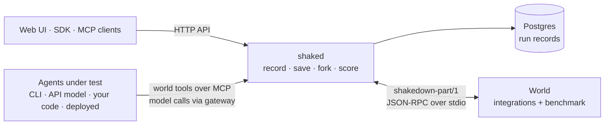

<p align="center">
  <picture>
    <source media="(prefers-color-scheme: dark)" srcset=".github/assets/banner-dark.svg">
    <source media="(prefers-color-scheme: light)" srcset=".github/assets/banner-light.svg">
    
  </picture>
</p>

<p align="center">
  <a href="https://docs.coppertide.ai">User guide</a> ·
  <a href="https://app.coppertide.ai/sd/">Hosted Shakedown</a> ·
  <a href="docs/concepts.md">Concepts</a> ·
  <a href="docs/reference.md">Reference</a> ·
  <a href="CONTRIBUTING.md">Contributing</a> ·
  <a href="LICENSE">Apache 2.0</a>
</p>

# Shakedown

Shakedown tests agent systems before they reach production. You build a simulated copy of the systems your
agents work with (a database, an ERP, a CRM, a plant), write a scenario, and run each agent setup against it as
many times as you need. Shakedown records every model call, every tool call and the state of every simulated
system at every step. Open any run, go back to any step, change one thing, fork, and compare the two branches.
It is for teams who need repeatable evidence of how their agents behave before those agents touch real systems.
Shakedown is a product of [CopperTide](https://coppertide.ai). This repository holds the open-source engine,
`shaked`.

- **Repeatable experiments.** An experiment runs each agent setup N times on the same world and scenario. Runs
  interleave across setups, and run *n* of every setup gets the same seed. Results show pass rate with a 95%
  range, the checks each run passed, cost, time and safety, side by side.
- **Deterministic scoring.** Checks on the final state of the world decide pass or fail, never a model. An
  optional AI review explains a run and never changes its score.
- **Limits live in the world, not the prompt.** A purchasing cap, an approval gate or a sandbox policy is
  enforced by the simulated systems. Every denied action is a recorded step with its reason.
- **Rewind the world, not only the transcript.** After each step that changes a system, shaked saves the
  system, or keeps what it needs to replay it. A fork puts every system back as it was just before the fork
  point. A fork that can't restore a system the way you asked is refused and names the system. Approximate
  restores are labelled.
- **Any agent.** Claude Code and Codex as headless CLIs, API models (OpenRouter, the OpenAI API, the Claude
  API, or your own OpenAI-compatible server), your own LangGraph, CrewAI or OpenAI Agents SDK code, an agent
  already deployed behind a URL, or a model on Amazon Bedrock.
- **Projects are files.** Worlds, scenarios, agent setups and experiments are YAML files in a project folder,
  edited in the app's editors and reviewed like code. Every project operation is also a tool of the in-app
  assistant and of Shakedown's MCP server.

| | Hosted Shakedown | Open-source engine (this repo) |
|---|---|---|
| Where | [app.coppertide.ai/sd](https://app.coppertide.ai/sd/) | Your own computer |
| Sign-in | Google or GitHub | None: one person at one machine |
| Projects | Built and edited in the app | A folder on your disk |
| Runs, rewind, fork | Arrive with the cloud sandbox runner, in progress | Work today |
| Usage analytics | PostHog, with all text and inputs masked ([privacy](https://docs.coppertide.ai/privacy)) | None: the UI never loads PostHog |

## Quick start

Run the engine locally with the included retail benchmark (customer service from
[tau2-bench](https://github.com/sierra-research/tau2-bench), on one Postgres database).

You need Docker, a stable [Rust](https://rustup.rs/) toolchain and Node.js (CI uses Node 24). For agents you
need either the `claude` or `codex` CLI on your `PATH`, signed in, or a model key (`OPENROUTER_API_KEY`,
`OPENAI_API_KEY` or `ANTHROPIC_API_KEY`, or one added later in the app). Install
[uv](https://docs.astral.sh/uv/) for the Python SDK and the Python integrations.

```bash
git clone https://github.com/CopperTide/Shakedown.git && cd Shakedown
docker compose -f deploy/compose.yml up -d        # Postgres on 127.0.0.1:5544 (loopback only)
cargo build --release                             # integrations and benchmarks, into core/target/release
(cd core && cargo build --release -p shaked)      # shaked, into the same folder
SHAKEDOWN_PROJECT=~/work/my-project core/target/release/shaked   # API on http://127.0.0.1:4510
```

In a second terminal, start the web UI:

```bash
cd ui && npm install && npm run dev               # UI on http://127.0.0.1:4520, proxying /api to :4510
```

Open <http://127.0.0.1:4520> and follow **Get started** at the bottom of the sidebar. It creates the project,
connects a model, and walks you through a world (runtime `retail`), an agent setup and a scenario. Then
**Experiments → New experiment** and **Deploy**. Click any run to read its timeline. A run's **⋯** menu rewinds
it to a step and reruns it with a change. The [user guide's quickstart](https://docs.coppertide.ai/quickstart)
has every step.

To serve the UI from shaked instead, run `npm run build` in `ui/`, then start shaked with
`SHAKEDOWN_UI_DIST=ui/dist`. UI and API are then both on port 4510. shaked listens on 127.0.0.1 only. Every
setting is an environment variable, listed in [docs/reference.md](docs/reference.md#configuration).

### From code

The engine is headless. The Python SDK ([docs/sdk.md](docs/sdk.md)) drives a running shaked. Save this as
`try.py` and run it from the repository root with `uv run --project sdk/python python try.py`:

```python
from shakedown import Shakedown, Agent

with Shakedown("http://127.0.0.1:4510") as sd:            # or Shakedown.local(...) to start a shaked
    run = sd.run("72", team=[Agent.claude_code("support", model="haiku")], seed=7)
    for event in run.events():                            # every step, live, until the run ends
        print(event.summary())
    print(run.check())                                    # passed, named checks, safety violations
    fork = run.rewind(event=10).fork(model="sonnet")      # the world as it was just before step 10
    fork.wait()
    print(sd.compare(run, fork))                          # first step that differs, rows that differ, metrics
```

Other languages use the [HTTP API](docs/reference.md#http-api) and its event stream. To test agents you
already run, give each one an MCP endpoint and a model gateway with `sd.external_run(...)`, or add it to a
team as an `http` or `bedrock` agent ([docs/agents.md](docs/agents.md)).

### From an agent

`shaked mcp` serves every project operation over stdio, on the project folder alone:

```bash
claude mcp add shakedown -- "$PWD/core/target/release/shaked" mcp --project ~/work/my-project
```

Your coding agent then lists, reads and writes worlds, scenarios, setups and experiments. Deploying an
experiment needs a running shaked: use its `POST /mcp` with an API token instead
([docs/reference.md](docs/reference.md#use-shakedown-from-an-agent-mcp)).

## What's in this repo

| Path | What it holds |
|---|---|
| [`core/`](core) | `shaked`, the engine: HTTP API, run recorder, forks, restores, compare, the MCP server. Also the package host and the `shakedown-part-check` conformance checker, and the project file formats. |
| [`ui/`](ui) | The web UI (React, Vite), one client of shaked's HTTP API. |
| [`sdk/python/`](sdk/python) | The Python SDK, `shakedown` (installs as `shakedown-sdk`), with framework adapters and [examples](sdk/python/examples). |
| [`kits/`](kits) | The Rust (`shakedown-part`) and Python (`shakedown_part`) kits for writing integrations and benchmarks. |
| [`integrations/`](integrations) | One package per kind of system: Postgres, MariaDB, a folder, any Docker Compose project, ERPNext, Twenty CRM, simulators and more. [List and status](integrations/README.md). |
| [`benchmarks/`](benchmarks) | Tasks, tools, seed data and checks. `retail` is the default and the others are opt-in. `world/` is the world builder. |
| [`docs/`](docs) | Developer docs: concepts, the protocol, packages, the SDK, the reference. |
| [`deploy/`](deploy) | The Postgres for local use (`compose.yml`), an [OpenShell sandbox](deploy/openshell) for Claude Code agents, a [RunPod GPU pod](deploy/runpod) for a self-hosted model, and the [E2B template](deploy/sandbox) hosted runs start from. |
| [`tools/`](tools) | [`worldclock-gateway`](tools/worldclock-gateway), which puts a simulated platform's telemetry on world time. |
| [`designs/`](designs) | Example agent designs written as customer code ([software factory](designs/software-factory)). |
| [`data/`](data) | Third-party data used by benchmarks (tau2-bench retail). |

Each system in a world is an **integration**: a separate program, in any language, that speaks
`shakedown-part/1` (JSON-RPC over stdin and stdout, [docs/protocol.md](docs/protocol.md)) with shaked. It
starts instances, runs tool calls, saves and restores state, and compares two states. A **benchmark** names
the integrations its world needs and brings the tasks and checks. The core depends on no integration and no
benchmark. A test checks this (`core/crates/parts/tests/isolation.rs`).



[docs/concepts.md](docs/concepts.md) explains runs, branches, saves, restore modes, teams and forking.

## How it fits

- **User guide:** [docs.coppertide.ai](https://docs.coppertide.ai) covers worlds, scenarios, agent setups,
  experiments, rewind and fork, and hosted Shakedown. Its source is in the
  [CopperTide](https://github.com/CopperTide/CopperTide) repository, `docs-site/`.
- **Hosted Shakedown:** [app.coppertide.ai/sd](https://app.coppertide.ai/sd/) runs this engine inside
  CopperTide's cloud layer, through the embedding interface in [docs/embedding.md](docs/embedding.md). That
  layer is not open source.
- **MADL:** agent setups of kind `madl` use the
  [Multi-Agent Descriptor Language](https://github.com/CopperTide/Multi-Agent-Descriptor-Language), an open
  file format for multi-agent systems.
- **Larger example worlds** (the factory) live in a separate repository that is not public yet. Tests that
  need them skip without it ([CONTRIBUTING.md](CONTRIBUTING.md#make-a-change)).

## Status

Shakedown is early. Claude Code and Codex runs are measured live ([docs/measurements.md](docs/measurements.md)).
API-mode providers, `http` and Bedrock agents and the framework adapters are tested against simulated servers.

<details>
<summary><b>Limits and not built yet</b></summary>

- A world runs through a runtime package: an installed benchmark or a built world, named in the world file's
  `package:`. Runs don't read a world file's connectors, flows, data, people or observability yet, nor a
  scenario's `changes`, `gates`, `checks` or event timing. Runs get the preset task's ticket. Setups of kind
  `code` and `madl` don't deploy from a file yet. See [docs/concepts.md](docs/concepts.md#project-files).
- Every project operation is on the MCP server and the assistant. Runs, forks and compare are HTTP API only.
- shaked's own runners run a team in sequence, all at once, or as a lead dispatching work. Any other team
  shape drives the run through the external API ([docs/concepts.md](docs/concepts.md#external-designs)).
- API mode has not been measured against a live provider. Costs a provider doesn't report are estimated only
  for the models in [`docs/prices.toml`](docs/prices.toml). Other costs show as unknown.
- A world made only of replay-only parts has no final save to compare, so its branches can't be scored.
- Not built: community publishing of packages (they install from a local folder), process checkpointing,
  fault search and design search.

</details>

## Development

Both Cargo workspaces (the repository root and `core/`) build into `core/target`, where shaked finds the
package programs. Start the Postgres from the quick start first, and stop shaked while tests run: its startup
cleanup drops the databases the tests make.

```bash
cargo fmt --all --check && (cd core && cargo fmt --all --check)
cargo clippy --workspace --all-targets -- -D warnings && (cd core && cargo clippy --workspace --all-targets -- -D warnings)
cargo test --workspace && (cd core && cargo test --workspace)
(cd kits/python && uv run --with pytest pytest -q)
(cd sdk/python && uv run pytest -q)
(cd ui && npm ci && npm test && npm run build)
```

Tests that need Docker services, real servers or real models are `#[ignore]`d with the prefix `live_` (Rust)
or marked `live` (Python), and CI skips them. [CONTRIBUTING.md](CONTRIBUTING.md) has the full checklist, how
to write an integration or a benchmark, and the code rules.

How the engine is built, with diagrams, invariants and where each is enforced: [docs/internals](docs/internals/README.md).

<details>
<summary><b>Renamed settings</b></summary>

The old names still work for now.

| Old name | New name | What still works under the old name |
|---|---|---|
| `SHAKEDOWN_PORT` | `SHAKEDOWN_BIND` (default `127.0.0.1:4510`) | `SHAKEDOWN_PORT=<port>` binds `127.0.0.1:<port>` |
| `SHAKEDOWN_AGENT_BASE` | `SHAKEDOWN_PUBLIC_URL`, the base of every URL shaked hands out | Still read, and it wins for HTTP agents |
| `SHAKEDOWN_LOCAL_MODELS` for your own model servers | Custom servers in **Connections & models** (`custom:<name>`, keys sealed in the database) | Still read. A custom server with the same name takes over. |
| shaked's tables in schema `public` | Schema `shakedown` | Moved on the first start, with runs and saves kept |

</details>

## Contributing, security and license

Contributions are welcome: integrations, benchmarks, fixes and docs. Read [CONTRIBUTING.md](CONTRIBUTING.md)
and follow the [Code of Conduct](CODE_OF_CONDUCT.md). Report security problems privately, as
[SECURITY.md](SECURITY.md) describes. Changes are listed in [CHANGELOG.md](CHANGELOG.md).

Shakedown is licensed under the [Apache License 2.0](LICENSE). The retail data in `data/retail/` comes from
[tau2-bench](https://github.com/sierra-research/tau2-bench), MIT License, Copyright (c) 2025 Sierra Research
(see [data/retail/LICENSE](data/retail/LICENSE) and [NOTICE](NOTICE)). To cite Shakedown, use
[CITATION.cff](CITATION.cff).
