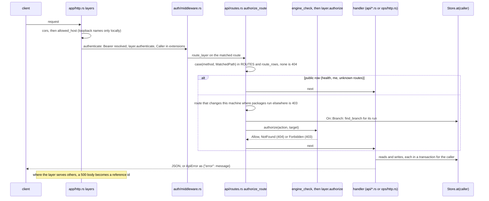
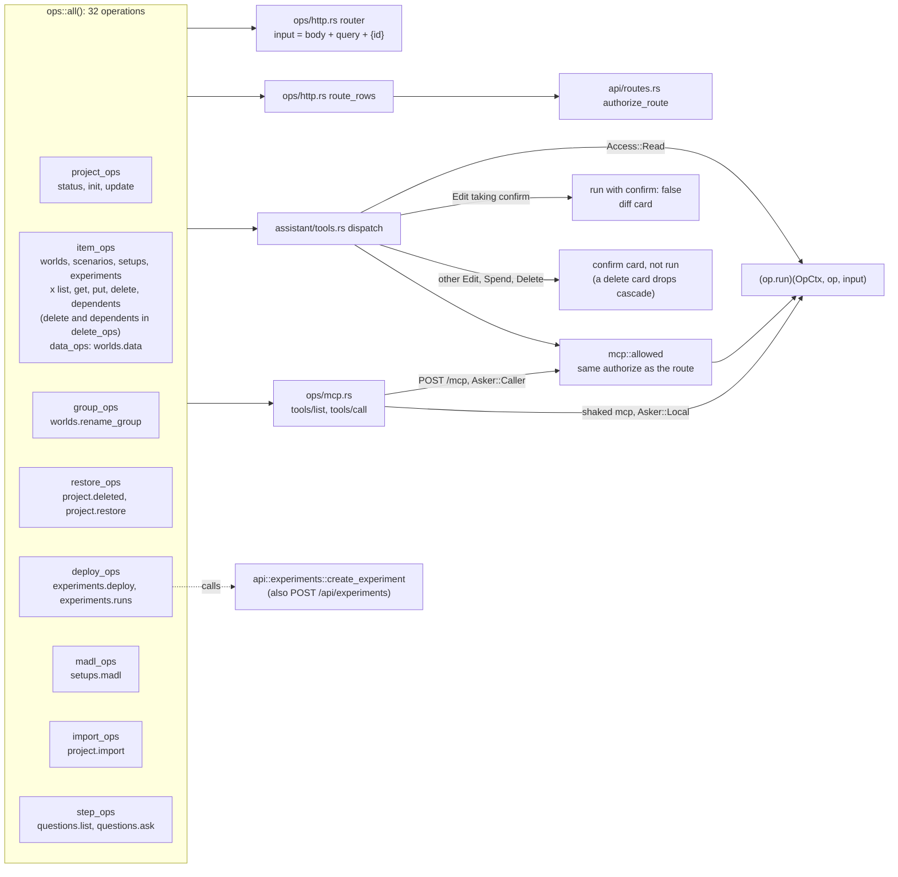
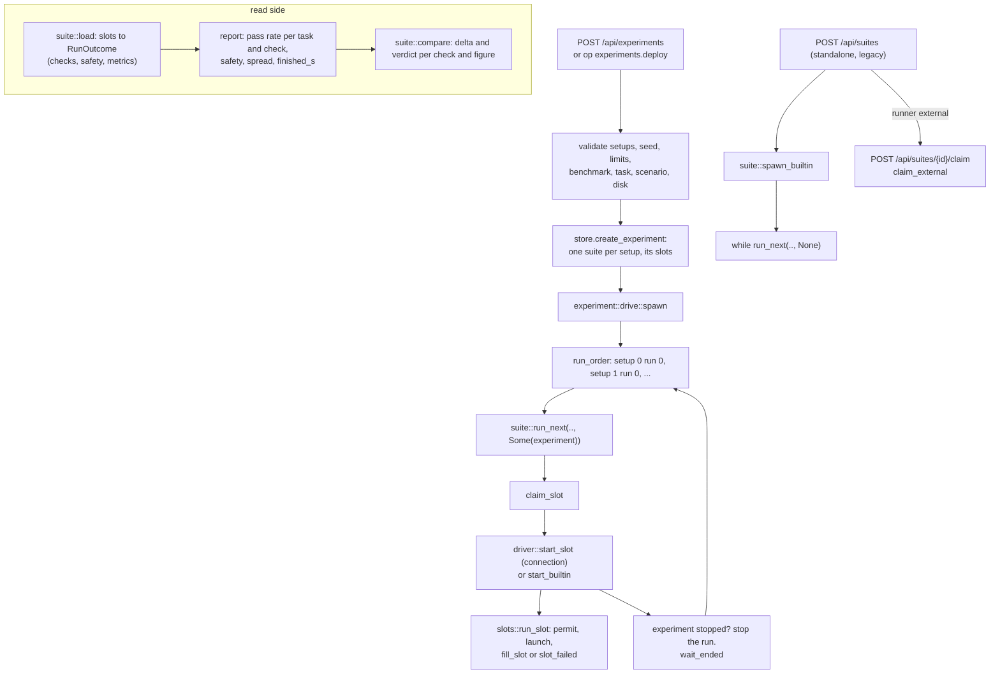
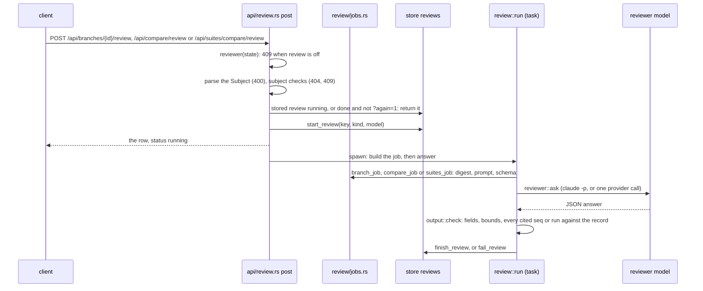

# API and operations

The HTTP service, the operation registry that HTTP, MCP and the assistant share, suites and experiments, and
review and metrics. Paths are relative to `core/crates/shaked/`.

## Job

shaked serves one HTTP API. The UI, the Python SDK, scripts and CI all use it. On top of that:

- the **operation registry** (`src/ops/`) defines each project operation once, and serves it as an HTTP
  route, a control MCP tool and an assistant tool
- **suites and experiments** run many branches and aggregate their scores
- **review, metrics and compare** read finished branches and summarise them.

## Modules

| Module | Job |
|---|---|
| `src/app/http.rs` | `router`: the middleware stack (CORS, Host guard, authenticate, authorize, hiding 500 text). |
| `src/app/mod.rs` | `Config`, `AppState`, drivers, `on_path`. |
| `src/api.rs` | `/api` router, shared helpers (`branch_or_404`, `pair`, `detached`, `check_disk`, `checked_seed`, `max_cost`, `world_minutes`), simple routes. |
| `src/api/routes.rs` | `ROUTES` (method, path, `Action`, `On`, public) and `authorize_route`. |
| `src/api/error.rs` | `ApiError {status, message}`, every `From`, and `authorize`. `ops::OpError` is the same type. |
| `src/api/extract.rs` | `JsonBody`, `OptionalJson`, `StartPermit` (cleanup read lock, 409, 507). |
| `src/api/runs.rs` | `POST /api/runs` read once into `RunAsk`, then `builtin`, `external` or `start_code`. List and delete runs. |
| `src/api/branches.rs` | Read a branch, fork it, restore plan. |
| `src/api/{flow,stream,rows,twin,recording,sandbox,names}.rs` | Pause, resume, stop, save, clock. SSE stream. Rows after a step. Views and scenario options. Recordings. Sandbox events. Display names. |
| `src/api/{external,connections,connect}.rs` | External-run routes. Code connections. Agent connection check. |
| `src/api/{suites,experiments,review,compare}.rs` | Suites, experiments, AI review, compare. |
| `src/api/{models,tokens,me,assistant,world,worlds,ui}.rs` | Model keys, API tokens, `/api/me`, the assistant chat, disk and gc, the world builder, serving the UI. |
| `src/ops/mod.rs` | `Operation`, `Access`, `OpCtx`, `all()`, `find()`, `diff_first`, input helpers. |
| `src/ops/http.rs` | Mounts every operation at its route, one route-table row each (`route_rows`). |
| `src/ops/mcp.rs` | The control MCP server: `POST /mcp`, operations as tools (`scenarios.put` is `scenarios_put`), `allowed`. |
| `src/ops/stdio.rs` | `shaked mcp`: the same handler over stdio, project folder only. |
| `src/ops/{project_ops,item_ops,data_ops,group_ops,restore_ops,deploy_ops,madl_ops,import_ops,observability_ops}.rs` | The operations, each module one area (`runs.export` sends a run to its observability targets). |
| `src/ops/{deploy,migrate,view,error}.rs` | Project experiment → engine mapping. Earlier work → project files. Item JSON. Errors. |
| `src/assistant/` | The Ask chat: `mod.rs` loop, `prompt.rs`, `tools.rs` (registry as tools, cards). |
| `src/project_state.rs` | The project folder, re-read when its files change. |
| `src/suite/` | `mod.rs` (slots), `drive.rs` (`run_next`, built-in loop, external claim), `slots.rs` (permit, paired seeds), `outcome.rs`, `safety.rs`, `report.rs`, `load.rs`, `compare.rs`. |
| `src/experiment/` | `mod.rs` (setups, `run_order`), `drive.rs`, `view.rs`. |
| `src/review/` | `jobs.rs` (`Subject`, jobs), `digest.rs`, `pair.rs`, `suites.rs`, `prompt.rs`, `reviewer.rs`, `output.rs` (citations checked), `settings.rs`; `ask.rs` (a step's sources, the answer's quotes checked), `asking.rs` (the question stored, the explainer on the asker's key), `ask_prompt.md`. |
| `src/metrics.rs`, `src/compare.rs` | Time, overhead, tokens and cost per agent. Branch summary, first divergent step, differing rows. |
| `src/api/observability.rs` | Observability targets, exports, exporting a run now, `GET /metrics` (see [observability](observability.md)). |
| `src/gc.rs` | Disk usage, deleting a run's saves, startup and manual cleanup. |

## An HTTP request

Rules a route keeps:

- **No route without a row.** Every `/api` route has a row in `ROUTES`, or is a registry operation with a row
  from `ops::http::route_rows`. `tests/routes.rs` parses the sources and checks the table against them, and
  that every route asks the layer (`every_api_route_asks_the_layer`).
- **Handlers do not authorize themselves.** The one extra check is `UseInRun` on the connection a Code run
  names (`src/api/runs.rs`).
- **Long work is detached.** `api::detached` spawns it, so a client that disconnects does not cancel a run or
  fork halfway.
- **No start during cleanup.** `StartPermit` takes the cleanup lock for reading and answers 409 while
  `POST /api/gc` holds it. `check_disk` answers 507 over `SHAKEDOWN_MAX_DB_BYTES`.
- **`/mcp` is mounted after the authorize layer**, so the control MCP server checks each tool call itself.
- **`/gateway`, `/mcp/{branch}/{agent}` and `/worker` are outside `/api`.** Each checks its own credential
  ([model traffic](model-traffic.md), [sandbox runs](sandbox-runs.md)).

The layer order in `router` is: `authorize` as a `route_layer` on `api::router`, `/mcp` added, the layer's own
routes merged, then `authenticate`, `allowed_host` and `cors` around all of `/api`. The world MCP, gateway and
worker routers are merged beside it. `hide_internal_errors` wraps everything only when the layer serves
others.

### Starting a run over HTTP

`POST /api/runs` reads the body once into `RunAsk` (`src/api/runs.rs`), then one of three starters runs its
own checks in its own order. `tests/precedence.rs` pins the order:

| Starter | When | Checks, in order |
|---|---|---|
| `builtin` | runner `chain`, `concurrent`, `dispatch` | team, spend limit, disk |
| `external` | runner `external` | agents, disk, spend limit and window |
| `start_code` | a Code connection | spend limit and window, launch guard (403, 415), runner, connection, agents, token envs, disk |

All three end in `launch::launch` ([runs and worlds](runs-and-worlds.md)).

## One registry for HTTP, MCP and the assistant

An `Operation` (`src/ops/mod.rs`) has a name (`<area>.<verb>`), area, summary, `Access`
(`Read`, `Edit`, `Spend`, `Delete`), HTTP method and path, an optional item kind, an input schema (from
`schemars`) and a handler. `OpCtx` carries the caller's project, the running shaked when there is one, and
the caller. Over stdio there is no shaked, and an operation that needs one answers 409.

Edits follow the project's `EditPolicy`. With `diff_first`, every operation taking `confirm` (a put,
`project.update`, `project.import`, `project.restore`, `worlds.rename_group`, a cascading delete) answers
`{proposed: true, …}` and writes nothing until it is sent again with `confirm: true` (`ops::diff_first`); a
restore's proposal carries the `trash` it is pinned to, and the assistant copies it into the card. Deletes go
through `Project::delete` (`core/crates/project/src/dependents.rs`: one reference walk, a plan checked before
any change, leaves first) and the trash (`trash.rs`); see [concepts](../concepts.md#project-files).

`worlds.data` (`GET /api/project/worlds/{id}/data`, read) lists the files in a world's data folder, `worlds/<id>/` (as `Project::kept_folder`)
(relative path and size, up to 500), or with `path` reads one: `{path, size, text, truncated}` for UTF-8 text (cut at
1 MiB), `{path, size, binary: true}` otherwise. A `path` that leaves the folder (`..`, absolute, or a symlink pointing
out) is 400 (`core/crates/shaked/src/ops/data_ops.rs`).

An operation under `/api/branches/{id}/` (`questions.list`, `questions.ask`) acts on that branch: its route row is
`On::Branch`, and an MCP call is asked the same as the route (`api::routes::ask`), so a hosted caller reaches only
its org's branches.

What the registry does not cover yet: runs, forks, branches, suites, engine experiments, reviews,
connections, keys and tokens are HTTP routes only. MCP clients and the assistant cannot use them. This is the
"registry coverage gap" in the backlog.

## Suites and experiments

- A suite is stored as its definition plus one slot per task × variant × repeat. Status and aggregates are
  worked out from the runs' records when read (`src/suite/mod.rs`).
- `slots::paired_seed(base, repeat)` gives every setup's repeat `r` the same seed, so setups are compared on
  the same worlds.
- Drive loops run one run at a time. A stopped experiment starts no more runs and stops the live one. On
  shutdown the loops exit without recording an end. The next start ends the suite or experiment with an error
  and marks its local branches `interrupted` (`jobs::interrupt_at_start`). A sandbox branch with a live worker
  token keeps running, and so do its suite and experiment.
- An experiment is N setups of one task, each a suite tagged with the experiment (`suites.experiment_id`,
  `setup_ord`). A suite made on its own reads as a one-setup experiment marked `legacy`
  (`src/experiment/view.rs`).

## Review, metrics and compare

- Reviews are keyed `branch:{id}`, `compare:{a}:{b}` and `suites:{a}:{b}` (`src/review/mod.rs`).
- A citation the record does not have is dropped and listed in `issues`. An item left with no citation is
  marked `unverified` (`src/review/output.rs`).
- `SHAKEDOWN_REVIEW=off` means nothing is sent to a model (`src/review/settings.rs`).
- `metrics.rs` counts only the branch's own events (`seq >= start_seq`). The inherited prefix belongs to the
  parent. Estimated production time is measured time minus Shakedown's overhead.
- `compare.rs` gives each branch's summary, the first divergent step and the rows the final worlds differ in.
  `GET /api/compare` and the pair review share `api::compare::compare_facts`.

## Invariants

| Invariant | Enforced in |
|---|---|
| Every `/api` route is authorized before its handler: engine check first, then the layer. NotFound is 404, Forbidden 403. | `src/api/routes.rs`, `authorize_route`. `src/api/error.rs`, `authorize` |
| The route table matches the routers. | `tests/routes.rs` |
| An operation is defined once. Its route, route row, MCP tool and assistant tool all come from that definition, and MCP over HTTP passes the route's own check. | `src/ops/mod.rs`, `src/ops/http.rs`, `src/ops/mcp.rs`, `allowed`. `tests/routes.rs`, `every_op_has_a_route_row` |
| The assistant never runs an operation that spends, deletes, or edits without a diff. | `src/assistant/tools.rs`, `outcome` |
| No run, fork or slot starts while a cleanup holds the lock. | `src/api/extract.rs`, `StartPermit`. `src/suite/slots.rs`, `permit` |
| A 500's text never reaches a caller where the layer serves others. | `src/app/http.rs`, `hide_internal_errors` |
| Answers about project items carry ids and names, never paths. | `src/ops/view.rs` |
| Locally only loopback Host names reach `/api`, whatever the config says. | `src/app/http.rs`, `router`. `src/bind.rs` |

## Extension points

- **A new HTTP route.** Add it in the module's `router()` and a row in `ROUTES`. `tests/routes.rs` fails until
  both exist.
- **A new operation.** Add it to one of the `*_ops.rs` lists. It appears as a route, an MCP tool and an
  assistant tool with no other change. Pick `Access` with care: it decides what the assistant runs without
  asking.
- **A new review subject.** Add a `Subject` variant, its key, shape and job builder (`src/review/jobs.rs`),
  and the route pair in `src/api/review.rs`.

## Tests

| Test | What it covers |
|---|---|
| `tests/routes.rs`, `tests/api.rs`, `tests/precedence.rs` | The route table, the API, the order of checks. |
| `tests/ops.rs`, `tests/control_mcp.rs`, `tests/project.rs`, `tests/madl.rs`, `tests/migrate.rs`, `tests/deploy.rs` | The registry over HTTP and MCP, project files, MADL, import, deploy. |
| `tests/assistant.rs` | Reads run, edits become diffs, spends become cards. |
| `tests/suites.rs`, `tests/experiments.rs` | Suites and experiments end to end. |
| `tests/review.rs`, `tests/review_routes_on.rs`, `tests/review_routes_off.rs` | Review jobs and routes, on and off. |
| `src/suite/report_tests.rs`, `src/review/digest_tests.rs`, `src/review/output_tests.rs` | Reports, digests, citation checks. |
