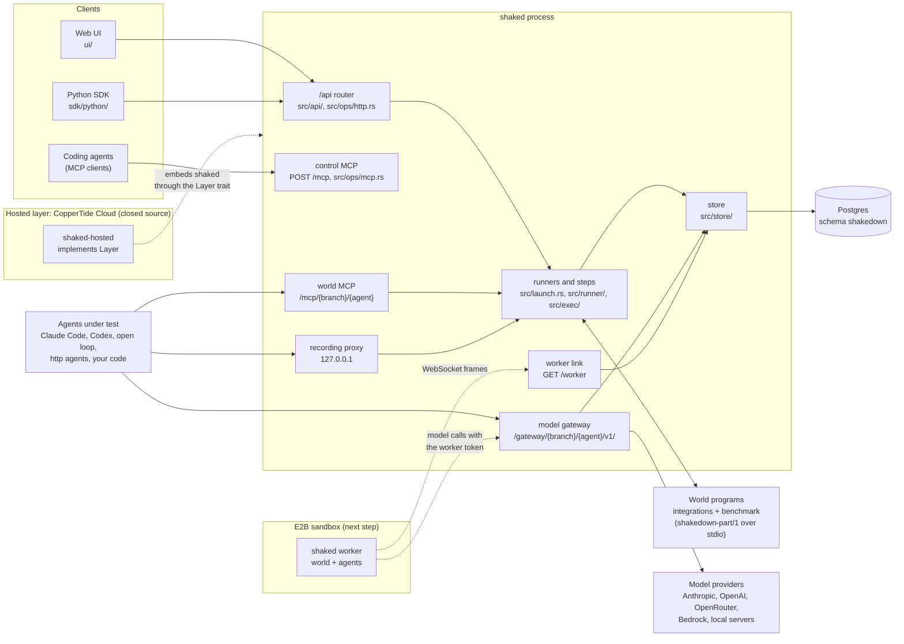
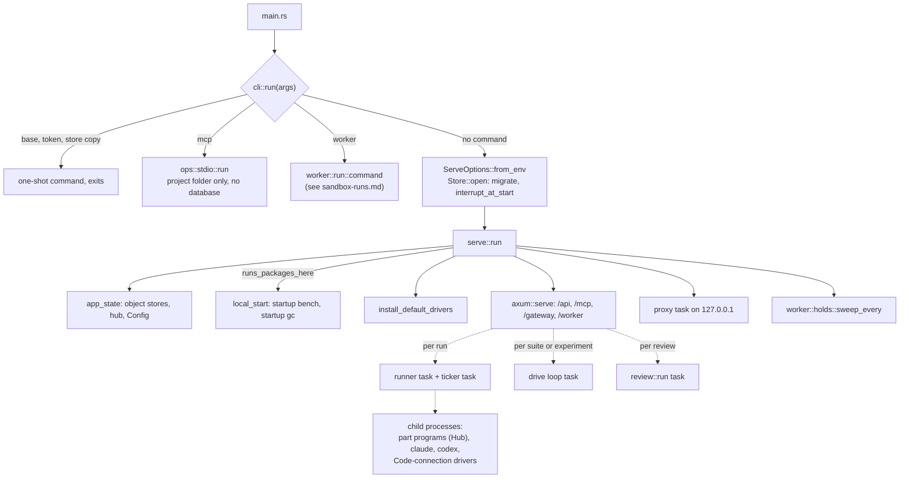

# Architecture

This page is the whole engine in one place: the processes, the crates and modules, the rules every change
must keep, and where to start reading. Each area has its own page with flows and invariants (see the
[index](README.md)).

Paths are relative to `core/crates/shaked/` unless they start with `core/`, `ui/`, `sdk/` or another top-level
folder. Everything here was checked against the code at commit `9048300`.

## The system in one page

`shaked` records runs of AI agents against a **world**: a set of real or simulated systems (Postgres, ERPNext,
a plant simulator) started as separate programs. Every tool call an agent makes goes through shaked, which runs
it on the world, saves the part it changed, and appends one event to the branch's log. Every model call goes
through shaked's gateway, which picks the key, calls the provider and appends one `model_call` event. Because
the world is saved (or replayable) at every step, any branch can be **forked** from any step: the new branch
gets the parent's events before that step and a world restored to how it was, then the agents run again with a
change.

What each box is:

- **Web UI** (`ui/`, React and Vite) and the **Python SDK** (`sdk/python/`) are clients of the same HTTP API.
  Neither has private routes.
- **Coding agents** (Claude Code, Codex) use the control MCP server to edit project files and deploy
  experiments. `shaked mcp` serves the same tools over stdio with no database (`src/ops/stdio.rs`).
- **Agents under test** reach the world only through three doors, all on the branch: the world MCP endpoint
  (`src/mcp.rs`), the model gateway (`src/gateway.rs`) and the recording proxy for their own HTTP clients
  (`src/proxy/`). Each door appends events to the branch.
- **World programs** are integrations and a benchmark, each a separate process that speaks
  `shakedown-part/1`, JSON-RPC over stdin and stdout ([protocol](../protocol.md)). `core/crates/parts` starts
  them lazily and shares one program per integration across every branch (`Hub`).
- **The store** (`src/store/`) is Postgres, schema `shakedown`. Every write goes through `Scoped`, a store
  bound to one caller, in its own transaction.
- **The hosted layer** is CopperTide Cloud's crate `shaked-hosted`. It implements the `Layer` trait
  (`src/layer.rs`) and starts shaked with `serve::run` ([embedding](../embedding.md)). The engine has no
  code for orgs or tenants. `tests/no_orgs.rs` checks that.
- **Product analytics (UI, hosted only):** when `/api/me` says `mode: hosted`, the UI reads the signed-in
  person, their org and a PostHog key from the gateway's `/gw/api/me` and starts PostHog
  (`ui/src/lib/productAnalytics.ts`): masked autocapture and replay, page addresses reduced to route
  templates, and a few named steps of the core flow (project, world, scenario, setup and experiment
  created; run and experiment run started; experiment deployed; fork made; compare opened). posthog-js is
  loaded only then, so a local shaked never loads it, and never with Global Privacy Control or Do Not
  Track on; in an EU or EEA time zone it stores nothing in the browser and records no replay. `ui/src/lib/posthogShared.ts` is kept identical to
  CopperTide's `web/src/hosted/posthogShared.ts`.
- **E2B workers** are the next step. The engine side is built: `shaked worker`, the link, the
  gateway forwarding, the control box's holds, the E2B backend that creates, writes into and kills a
  sandbox (`src/hosting/e2b.rs`), and the E2B template a sandbox starts from (`deploy/sandbox`), with CLI
  agents jailed in containers (see [sandbox runs](sandbox-runs.md)). What starts a sandbox for a branch
  (`Hosting`, M2a Task 7 onward) is not in the engine yet. Today only tests hand a worker its ticket.

## Crates

| Crate | Path | Job |
|---|---|---|
| `shaked` | `core/crates/shaked` | The engine: HTTP API, runners, gateway, proxy, store, worker. A library plus the `shaked` binary. |
| `parts` | `core/crates/parts` | Package manifests and registry, the JSON-RPC client to part programs, the `Hub`, and the `shakedown-part-check` conformance checker. |
| `shakedown-project` | `core/crates/project` | Project folder formats (world, scenario, setup, experiment, `shakedown.yaml`), load, validate, write. |
| `shakedown-schema` | `core/crates/shakedown-schema` | The SQL migrations as files and a generic migrator with checksums. |
| `shakedown-part` | `kits/rust` | The kit integrations and benchmarks are written with. `parts` re-exports its `proto` wire types. Core crates never depend on an integration or benchmark (`core/crates/parts/tests/isolation.rs`). |

Outside `core/`: `kits/python` (the Python kit), `integrations/*` and `benchmarks/*` (packages), `sdk/python`
(the SDK and framework adapters), `ui/` (the web UI).

## Module map of `shaked`

One line per module of `src/lib.rs`, grouped by area. The area pages go one level deeper.

### Process and HTTP

| Module | Job |
|---|---|
| `main.rs` | Reads the environment (documented in its header), runs a sub-command or serves over `LocalLayer`. |
| `cli` | `shaked base`, `token create`, `store copy`, `mcp`, `worker`. |
| `serve` | `ServeOptions::from_env` and the start-up: object stores, `AppState`, vault check, base and gc, router, proxy, link sweep, graceful shutdown. |
| `app` | `Config`, `AppState` (store, hub, live branches, links, proxy, cleanup lock), the drivers. `app/http.rs` is the router and its middleware. |
| `api` | The `/api` routes, one file per concern, plus `api/routes.rs` (the route table) and `api/error.rs` (`ApiError`, `authorize`). |
| `bind` | Where shaked listens, the URL it hands out, the allowed Host names, and `local_only`. |
| `jsonrpc` | JSON-RPC envelopes shared by the two MCP servers. |
| `live` | `LiveBranches`: the branches running in this process. |
| `jobs` | Background work with no caller: interrupt at start, the linked branches, ending a linked branch. |
| `pg` | Postgres admin: create the database, connect. |
| `harness` | Test harness for shaked and embedders (feature `harness`): spy layer, scratch databases, served app. |

### Runs, branches and steps

| Module | Job |
|---|---|
| `launch` | The one entry for every new run: admit, `begin_run`, meter, then start the branch as its runner says. |
| `runner` | `record_start` and `stand_up` (the two halves of starting), the chain and concurrent runners, scoring, how a branch ends. |
| `dispatch` | The `dispatch` runner: a lead delegates, agents wake on mail. `board.rs` is a pure state machine. |
| `external` | Runs an external system drives: agent endpoints, register, report, finish. |
| `driver` | Launches and watches a Code connection's driver process for one run. |
| `exec` | `BranchCtx` (a live branch) and `ToolExec`, the one place a step runs, saves and records. |
| `window` | World time window of an external run: scored when the branch clock reaches it. |
| `flow` | Pause and stop of a live branch. Paused calls wait, stopped calls are refused. |
| `clock` | `BranchClock`: world milliseconds that stand still while the world is paused. |
| `world_clock` | Maps the branch clock onto the task's calendar date for agents. |
| `ticker` | One task per branch that advances the world's clock parts about every 200 ms. |
| `overhead` | Shakedown's own time, carried on the next event as `overhead_ms`. |
| `scenario` | A run's disruptions, expanded with the benchmark's templates into setup calls. |
| `budget` | A run's spend estimate and limit. `prices` holds the list prices of `docs/prices.toml`. |

### World, saves and forks

| Module | Job |
|---|---|
| `world` | `World`: one instance per part, tool routing, gates, links, saving, scoring, views, proxy hosts, base and gold saves. |
| `world_builds` | Background builds of world packages and the remembered current benchmark. Not the live `World`. |
| `save_calls` | Hub calls on saves outside a live world: inspect, diff, drop, measure. |
| `fork` | Plan where a fork starts, decide how each part is restored, create and start the child branch. |
| `restore` | The restore table: a part's declaration × the restore asked for → save or replay. |
| `replay` | Restore a part by repeating its recorded inputs onto a fresh instance. |
| `recorded` | Pure reads of an event list: run info, clock at a seq, saves at a seq, final saves. |
| `gc` | Disk usage, deleting a run's saves, the startup cleanup of saves no event names. |
| `objects` | Object storage (R2, S3, files, memory) for saves and transcripts. `shaked store copy`. |

### Model traffic and agents

| Module | Job |
|---|---|
| `gateway` | The recording model gateway: `chat/completions`, `messages`, `responses`, `count_tokens`. |
| `providers` | Provider adapters (OpenAI-compatible, Anthropic, Bedrock), key resolution, reach guards. |
| `agents` | The `Driver` trait and its drivers: shaked's open loop, Claude Code, Codex, `http` agents. |
| `mcp` | The per-agent world MCP endpoint `/mcp/{branch}/{agent}`. |
| `proxy` | The recording HTTP(S) proxy for agents' own clients, one CA per branch. |
| `reasoning` | Pulls reasoning out of model responses and records it as `reasoning` events. |
| `secrets` | Header secrets of `http` agents, kept in memory and named by reference. |
| `vault` | AES-256-GCM sealing of stored model keys. |

### Sandbox worker

| Module | Job |
|---|---|
| `worker` | `shaked worker` (the engine in a sandbox) and the control box's end of its link: frames, tickets, links, holds, the sweep. |

### Auth and layer

| Module | Job |
|---|---|
| `auth` | `Caller`, `engine_check` (scopes and own-branch rules), the `/api` middleware, API and run tokens, system scopes. |
| `layer` | The `Layer` trait a deployment implements, `LocalLayer`, `WorkerLayer`, `Policy`. |

### Registry, assistant and analysis

| Module | Job |
|---|---|
| `ops` | The operation registry: each project operation defined once and served as HTTP route, MCP tool and assistant tool. |
| `assistant` | The Ask chat on the user's own model, with the registry as its tools. |
| `project_state` | The project folder shaked serves, re-read when its files change. |
| `suite` | Suites: slots of task × variant × repeat, the drive loop, outcomes, reports, comparison. |
| `experiment` | Experiments: N setups of one task, each stored as a suite, run interleaved. |
| `review` | AI review of a run, a pair of runs or a pair of suites, with citations checked against the record. |
| `metrics` | A branch's time, overhead, tokens and cost per agent. |
| `compare` | Branch summary, first divergent step, differing final rows. |
| `prompts` | The suggested team and the heading over the benchmark's instructions. |

### Data

| Module | Job |
|---|---|
| `store` | `Store` (pools, layer, per-branch locks, event broadcast) and `Scoped` (every record method). |
| `model` | `Event`, `EventKind`, `Branch`, `Team`, `Rules`, `Hold` and the typed payloads. |
| `text` | Cutting long text and JSON on char boundaries. |
| `testkit` | Event and branch builders for unit tests (`cfg(test)`). |

## Process layout

One `shaked` process holds everything in memory that is live: `AppState.live` (branches running here),
`AppState.links` (sandbox links and tickets), `AppState.proxy` (proxy tickets and CAs). Everything durable is in
Postgres. On start, `jobs::interrupt_at_start` marks what was running as `interrupted`
(`src/jobs.rs`), because a local branch cannot survive its process. A branch a sandbox's worker runs is the
exception: its link is rebuilt from the store when the worker rejoins (`src/worker/link.rs`, `rebuilt`).

Ctrl-C sets `AppState.shutdown`, which ends the SSE streams and the drive loops, and the process exits after
5 s at most (`src/serve.rs`, `shutdown_on_ctrl_c`).

## Core invariants

Each of these holds across the whole engine. A change that weakens one needs a design discussion first.

### 1. The world is deterministic, the agents are not

A part restored for a fork must reach the same state it had at the fork point. Two ways do that: a save made
after every write step, or a replay of the part's recorded inputs with the run's seed. Agents are real models
and never replayed: a fork copies the parent's events before its start and runs the agents live from there.

| Where | How it holds |
|---|---|
| `src/runner/start.rs`, `run_start` | `RunStart` records the seed, the base saves and each part's fingerprint. |
| `src/exec/branch.rs`, `enter_step` and `gate` | Every step holds the branch gate, so world order, save order and event order agree. The ticker (`ToolExec::tick`) and scoring take the same gate. |
| `src/exec.rs`, `save_step` | Every step that wrote saves its part, or records `snapshot_error`. |
| `src/replay.rs` | A replay starts fresh with the run's seed at clock 0 and must get back each recorded result ("replay diverged" otherwise). |
| `src/fork/rerun.rs`, `check_fingerprints` and `Rerun::check` | An exact fork refuses changed worlds, approximate ancestry and fingerprint drift. |
| `docs/protocol.md`, "Determinism contract" | What a part promises for `exact: "replay"`. `shakedown-part-check` tests it. |

### 2. Record, then replay from the record

Everything an agent does reaches the world through shaked and is recorded once: a tool call as one
`tool_call`, a model call as one `model_call`, a proxied request as one `http` tool call. Forks, replays,
compare, metrics, review and export read only the record.

| Where | How it holds |
|---|---|
| `src/exec.rs`, `ToolExec::run_outcome` and `record_step` | The only path from an agent's tool call to the world. |
| `src/gateway/book.rs`, `CallFor::book` | One `model_call` per call, then its reasoning, then the meters. |
| `src/exec/http.rs` | A proxied request runs as a step and is recorded as tool `http` of the part serving the host. |
| `src/exec/setup.rs`, `src/exec/links.rs` | Setup calls (actor `setup`) and link calls (actor `link`) are recorded as tool calls, so a replay repeats them. |
| `src/fork/plan.rs`, `resume_from_model_call` | An open agent resumes a fork from the messages of its recorded model call. |

### 3. One event log per branch, ordered by `seq`

`seq` is dense, starts at 1 with `RunStart`, and is assigned only by the store of the control box. A fork's
events are the parent's rows with `seq < start_seq`, seqs kept.

| Where | How it holds |
|---|---|
| `src/store/events.rs`, `append_with` | `INSERT … coalesce(max(seq), 0) + 1` under `Store::lock_for(branch)`. |
| `core/crates/shakedown-schema/migrations/shakedown/0001_baseline.sql` | Primary key `(branch_id, seq)` as the backstop. |
| `src/store/linked.rs`, `append_linked` | A worker's events take the same lock and are idempotent per `link_n` (unique index from 0004). |
| `src/gateway/target.rs`, `CallFor::append` | The control box's own events for a linked branch go through the same `append`, so they interleave in one order. |
| `src/store/events.rs`, `copy_prefix` | A fork copies the prefix with the parent's seqs. |

### 4. The control box is the authority for sandbox runs

A sandbox is not trusted. The control box keeps the run's rules, the spend estimate, the pause or stop, and the
final status, all in Postgres so a restart keeps them.

| Where | How it holds |
|---|---|
| `src/runner/start.rs`, `record_start` → `src/store/control.rs`, `set_rules` | The rules on record are the control box's. A fork copies them with `inherit_rules`. |
| `src/worker/holds.rs`, `keep` | A hold is written to `branches.hold` first, then to the link, under the branch lock. |
| `src/gateway/linked.rs`, `Linked::held_back` and `settle` | Pause, stop and spend limit are enforced on every model call before any provider sees it. |
| `src/worker/link.rs`, `ended` | A stopping hold wins over the status the worker reports. |
| `src/worker/holds.rs`, `sweep` | Re-arms a lost end grace after a restart and ends branches whose worker token died. |

### 5. No model key in a sandbox

The sandbox holds one credential: its branch's worker token. Model keys stay on the control box, which adds the
key when it calls the provider.

| Where | How it holds |
|---|---|
| `src/layer.rs`, `WorkerLayer` | `keeps_secrets() == false` and `environment_keys: false`: no vault, no environment keys. |
| `src/worker/run.rs`, `worker_app` | `ProviderConfig::without_environment()` and a store with no database (`Store::detached`). |
| `src/gateway/forward.rs`, `onward` | A forwarded call carries the worker token, the content type and the API version headers, nothing else. |
| `src/agents/cli.rs`, `scrub_env` | CLI children get an environment with secrets removed, then the gateway route. |
| `src/gateway/admit.rs`, `provider` → `src/providers/keys.rs`, `provider_for` | The control box picks the key for the branch's caller. |
| `tests/worker_run.rs`, `a_workers_model_calls_carry_no_model_key_and_are_recorded_once` | The end-to-end check. |

## Where to start reading

1. `src/main.rs` (the environment) and `src/serve.rs` (the start-up).
2. `src/launch.rs`, then `src/runner/start.rs` and `src/runner/lifecycle.rs`: a run from request to end.
3. `src/exec/branch.rs` and `src/exec.rs`: what a live branch is and how one step runs.
4. `src/store.rs` and `src/store/events.rs`: how an event is written.
5. `src/gateway.rs` (its header has the call path) and `src/gateway/admit.rs`.
6. `src/app/http.rs` and `src/api/routes.rs`: how a request is routed and authorized.
7. The area pages: [runs and worlds](runs-and-worlds.md), [model traffic](model-traffic.md),
   [API and operations](api-and-ops.md), [sandbox runs](sandbox-runs.md), [data model](data-model.md).
