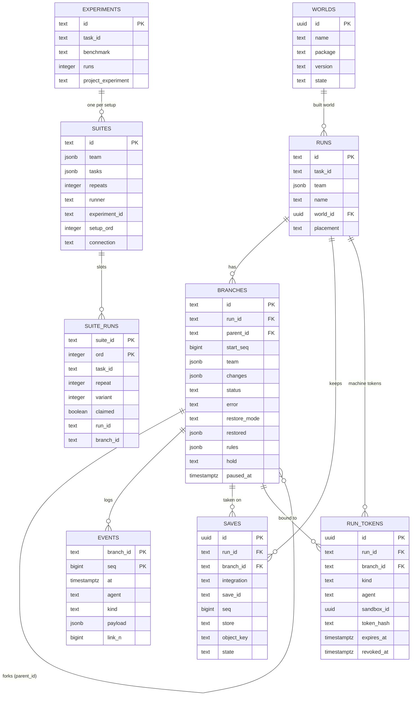
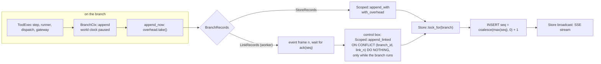

# Data model

The tables, how migrations are applied, and the main types and events. Paths are relative to
`core/crates/shaked/` unless they start with `core/`.

## Job

Postgres holds everything durable, in schema `shakedown`. Every pooled connection sets
`search_path = shakedown, public` (`src/store/open.rs`). Runs, branches and events are the record. Everything
else (suites, experiments, reviews, keys, tokens, connections) hangs off it or stands beside it. Nothing in the
open-source schema names an owner: orgs and tenancy belong to the hosted layer, which adds its own stream of
migrations on top (`tests/no_orgs.rs` keeps the engine free of them).

## Modules

| Module | Job |
|---|---|
| `core/crates/shakedown-schema/migrations/shakedown/` | The SQL, one numbered file per version. |
| `core/crates/shakedown-schema/src/` | Embedded files (`stream.rs`), the migrator (`migrator.rs`), retired files (`retired.rs`). |
| `src/store/open.rs` | `prepare_db`: refuse a retired database, migrate stream `shakedown`, set the search path. The pool. |
| `src/store.rs` | `Store` (pools, layer, per-branch locks, event broadcast), `Scoped` (one caller, one transaction per call, `in_tx`). |
| `src/store/tx.rs` | `Tx`: `BEGIN` then the layer's `begin` hook. Dropped without commit, its connection closes. |
| `src/store/runs.rs`, `events.rs`, `linked.rs`, `control.rs` | Runs and branches, the event log, worker events, rules and holds. |
| `src/store/{suites,experiments,reviews,connections,provider_keys,api_tokens,run_tokens,saves}.rs` | The other tables, one file each. |
| `src/store/project_items.rs`, `project_history.rs` | A project's state (shakedown 10): settings and items with a revision check per row; changes and import records. Nothing reads them yet. |
| `src/model.rs`, `src/model/` | `Event`, `EventKind`, `Branch`, `RunSummary`, `Team`, `AgentSpec`, `Change`, `Rules`, `Runner`, `BranchStatus`. `hold.rs`, `team.rs`, `agent_in.rs`, `payloads.rs`. |

## Migrations

| Version | File | What it adds |
|---|---|---|
| 1 | `0001_baseline.sql` | Moves the old tables from `public` into `shakedown` when present, then `runs`, `branches`, `events`, `suites`, `suite_runs`, `experiments`, `reviews`, `connections`. Idempotent, so it also brings an older database up to date. |
| 2 | `0002_keys_worlds_saves_tokens.sql` | `runs.world_id`, `runs.placement` (`local`, `cloud`, `record`), `connections.sealed_env`. Tables `provider_keys`, `worlds`, `saves`, `api_tokens`, `run_tokens`. Indexes on branches. |
| 3 | `0003_project_experiments.sql` | `experiments.project_experiment`: the project experiment file a deployment came from. |
| 4 | `0004_event_link_n.sql` | `events.link_n` and the unique partial index `(branch_id, link_n) WHERE link_n IS NOT NULL`. |
| 5 | `0005_branch_rules_hold.sql` | `branches.rules`, `branches.hold` (`paused`, `stopping`, `budget_exceeded`), `branches.paused_at`. |
| 6 | `0006_observability.sql` | Tables `observability_targets` (headers sealed, `header_names` listed) and `observability_exports` (one row per target and branch: state, attempts, next try). See [observability](observability.md). |
| 10 | `0010_project_state.sql` | A project's state in tables: `projects`, `project_scenarios`, `project_setups`, `project_setup_files`, `project_experiments`, `project_changes`, `project_change_items`, `project_imports`; `experiments.project_experiment_id`. See [project state tables](#project-state-tables). |

How they are applied (`core/crates/shakedown-schema/src/lib.rs`, `migrator.rs`):

- A stream is a name (`shakedown`). A hosting binary embeds its own streams beside the base and passes the set
  to `migrate`, which applies the streams its plan names.
- Each applied version is recorded with its sha256 in `schema_meta.migrations`. A database whose applied file
  differs from the embedded one is refused.
- Each stream migrates under its own advisory lock.
- Migrations are append-only. A destructive statement needs a `-- contract: unused since <sha>` line
  (`core/crates/shakedown-schema/tests/files.rs`).
- Every new column is nullable or has a default, so adding it rewrites nothing.
- `retired.rs` lists files an unreleased build applied. `prepare_db` refuses such a database with a hint
  before anything is written.

## Tables



Tables with no foreign keys to the record: `reviews` (keyed `branch:<id>`, `compare:<a>:<b>`,
`suites:<a>:<b>`), `connections` (a Code connection's command, its secret env sealed), `provider_keys` (sealed
key, last 4, prices, check result), `api_tokens` (hash, prefix, scopes, expiry, revoke).

What each table is for, and who writes it:

| Table | Written by | Notes |
|---|---|---|
| `runs` | `store/runs.rs`, `create_run` | One per run. `placement` is in the schema for hosted runs. |
| `branches` | `store/runs.rs`, `store/control.rs` | `start_seq` is null for a run's first branch. `rules` and `hold` are the control box's (see [sandbox runs](sandbox-runs.md)). |
| `events` | `store/events.rs`, `store/linked.rs` | The log. Primary key `(branch_id, seq)`. `link_n` only on events a worker sent. |
| `saves` | `store/saves.rs`, `record_save` | Uploaded saves, fork-ready when `state = 'ready'`, kept 30 days. No caller in `src/` writes rows yet: uploads come with hosted forks (M2b). |
| `worlds` | none in the engine yet | Built worlds kept in object storage. Locally built worlds live in `SHAKEDOWN_WORLDS` and are not rows. |
| `run_tokens` | `store/run_tokens.rs` | Run (`sdr_`), worker (`sdw_`) and ticket rows, hash only. Agent tokens (`sda_`) are in memory only. |
| `api_tokens` | `store/api_tokens.rs` | `sd_` tokens, hash only, each change audited through the layer. |
| `provider_keys` | `store/provider_keys.rs` | Each secret sealed to its row (`vault::key_context`). One key per name, checked under an advisory lock. |
| `suites`, `suite_runs` | `store/suites.rs` | Definition plus one slot per task × variant × repeat. |
| `experiments` | `store/experiments.rs` | Its setups are suites with `experiment_id` set, ordered by `setup_ord`. |
| `reviews` | `store/reviews.rs` | One row per subject, kept until asked again. |
| `connections` | `store/connections.rs` | Code connections. |

## Project state tables

Migration 10 makes the tables a project's state moves into (plan `2026-11-27-project-state-in-databases`). In this
release nothing reads them: projects still live in their folder, or in a hosting layer's files.

- `projects` holds `shakedown.yaml` in typed columns. The store reads and writes it as a `ProjectFile`.
- `project_scenarios`, `project_setups` and `project_experiments` hold each item's `body`: the item exactly as its
  file says, `format:` included. Generated columns (`label`, `world`, `scenario`, `parent`, `team_kind`) are there
  for lists.
  - References between items stay names inside `body`, with no foreign keys, so export and import round-trip.
  - A slug is unique among a project's live items. A delete sets `deleted_at` and frees the slug.
- Every write names the `revision` it read. When the row has moved past it, the write is refused with `Stale`, and
  a duplicate slug is refused with `SlugTaken`.
- `project_changes` and `project_change_items` hold the undo history, and will replace `.shakedown/trash`. Each item
  keeps a row's body before and after (with the revision the change left), or a file's bytes.
- `project_imports` holds one record per git import, and will replace `import.json`. A re-import replaces it.
- A local shaked will keep scenarios and setups as files, so their tables stay empty there. A hosting layer keeps
  them as rows, and adds its own columns and keys on top.

```text
Scoped::put_project_item ─► in_tx ─► put_item_in ─► INSERT, or UPDATE … WHERE revision = base
                                                     ├─ no row ─────────► Stale { based_on, current }
                                                     └─ unique violation ► SlugTaken
```

The `_in` functions take an open `Tx`, so a later change set can write several rows in one transaction.

## How an event is written



- The per-branch lock is in-process (`Store::locks`). The primary key is the backstop against two processes.
- `Store::branch_lock` hands out the same lock to the worker code: a linked branch's hold, end and rebuilt link
  are decided under it too.
- `overhead_ms` on an event is Shakedown's time since the previous event (`src/overhead.rs`). Summed over a
  branch's events it is the time Shakedown added.
- A fork copies the parent's rows with `seq < start_seq` and keeps their seqs (`copy_prefix`). The child's own
  events go on from `start_seq`.

## Event kinds

20 kinds (`EventKind` in `src/model.rs`), each with a typed payload (`payload_kind!` in
`src/model/payloads.rs`). Payloads are written with `BranchCtx::record` and read with `Event::decode`.

| Kind | Payload | Recorded by |
|---|---|---|
| `run_start` | `RunStartPayload`: task, team, benchmark, world, seed, base_seed, fingerprints, base saves, runner, handoff, systems, tools, scenario, world_epoch_ms | `runner/start.rs`, `start_world` (seq 1) |
| `agent_start` | `AgentStartPayload` | runners, `external::go`, `register` |
| `model_call` | `ModelCallPayload`: request, response, usage, cost_usd, cost_source, provider, provider_response, duration_ms (plus `api`, `stream`, `interrupted`, `charged_usd`, `estimated` on raw calls) | `gateway/book.rs`. Client-reported for Claude Code outside a worker, and external usage reports |
| `tool_call` | `ToolCallPayload`: name, args, result, error, reads, writes, part, saves, clock_ms, paused_ms, duration_ms, tool_call_id | `exec.rs`, `record_step` (agents, `setup`, `link`, `http`) |
| `handoff`, `message` | `HandoffPayload`, `MessagePayload` | `exec/talk.rs` |
| `delegation`, `report`, `finish` | `DelegationPayload`, `ReportPayload`, `FinishPayload` | `exec/dispatch.rs` |
| `wake`, `idle` | `WakePayload`, `IdlePayload` | `dispatch/` |
| `agent_end` | `AgentEndPayload` | runners, external `report` |
| `check` | `CheckPayload`: passed, checks, differing_rows, final_saves, unchecked | `runner/score.rs` |
| `world_event` | `WorldEventPayload`: part, kind, text, data, clock_ms | `exec/links.rs`, the gateway's `budget/limit_reached`, drivers, sandbox events |
| `world_view` | `WorldViewPayload`: seq_of, view | `exec/view.rs` (bookkeeping, no step) |
| `pause`, `resume` | `PausePayload`, `ResumePayload` (paused_ms) | `exec/branch.rs` |
| `reasoning` | `ReasoningPayload`: text, kind, source, model_call_seq, truncated | `reasoning.rs`, the gateway, drivers |
| `save_point` | `SavePointPayload`: reason, saves, error, paused_ms | `exec/save_point.rs` (bookkeeping, no step) |
| `spans` | `otel::imported::SpansPayload`: the spans an agent's own OTel SDK sent (one request each) | `otel/receive.rs` |

Payloads typed after their events were first written (`RunStart`, `AgentStart`, `Wake`, `Idle`, `Resume`,
`Reasoning`) read every field leniently, so a run recorded by an older shaked still reads. JSON shapes are
pinned byte for byte in `src/model/payloads/tests.rs`. Recorded runs are data: never change a payload's JSON
without a reader for the old shape.

## Main types

| Type | Where | What it is |
|---|---|---|
| `Event` | `src/model.rs` | A row of `events`: branch_id, seq, at, agent, kind, payload. |
| `Branch`, `RunSummary` | `src/model.rs` | Branch and run rows as the API shows them. |
| `Team`, `AgentSpec`, `AgentKind` | `src/model.rs`, `src/model/team.rs`, `src/model/agent_in.rs` | A team and its agents (`claude_code`, `codex`, `open`, `external`, `http`, Bedrock read as `open`). |
| `Change` | `src/model.rs` | One agent's change in a fork: prompt, model, kind, provider, read_only, tools. |
| `Rules`, `Runner` | `src/model.rs` | runner, handoff_required, max_cost_usd, connection, world_minutes. |
| `BranchStatus` | `src/model.rs` | `running`, `queued` (a cloud run waiting for its sandbox slot), `passed`, `failed`, `infra_error`, `interrupted`, `stopped`, `budget_exceeded`. |
| `Hold` | `src/model/hold.rs` | `Running`, `Paused`, `Stopping(status)`, stored as `branches.hold`. |
| `BranchPlan` | `src/runner/start.rs` | Serialisable: everything a worker needs to stand a branch up. Travels in `Start`. |
| `LaunchSpec`, `Launched` | `src/launch.rs` | What a new run is, and what starting it returned. |
| `BranchCtx` | `src/exec/branch.rs` | A live branch: world, roster, clock, flow, rules, budget, mailbox, lifecycle, overhead, records, gate, caller. |
| `ForkRequest`, `ForkPlan`, `Rerun` | `src/fork/` | Fork input, start point, restore plan. |
| `Caller` | `src/auth/caller.rs` | The person, an API token, or a run token bound to one branch. A layer may add its own principal in `ext`. |

## Invariants

| Invariant | Enforced in |
|---|---|
| Every record method runs in a transaction for one caller, opened through the layer's `begin`. | `src/store.rs`, `Store::at`, `Scoped::in_tx`. `src/store/tx.rs` |
| A transaction dropped without commit never goes back to the pool mid-transaction. | `src/store/tx.rs` |
| A branch of a run the caller cannot see is not found. | `src/store.rs`, `BRANCHES_OF_RUNS`, `VISIBLE_BRANCH` |
| Secrets are stored sealed or hashed, never plain: tokens by sha256, keys and connection env sealed to their row. | `src/auth/tokens.rs`, `src/vault.rs`, `src/store/provider_keys.rs` |
| Tests never migrate someone's database: under `SHAKEDOWN_TEST_GUARD` the default database is refused. | `src/store.rs`, `db_setting` |
| The open-source schema names no owner. | `tests/no_orgs.rs`, `tests/no_orgs_allow.txt` |

## Extension points

- **A new column or table.** Add the next numbered file under `migrations/shakedown/` and list it in
  `BASE_FILES` (`core/crates/shakedown-schema/src/stream.rs`). Never edit an applied file. Keep columns
  nullable or defaulted.
- **A new record method.** Put it in the `store/` file for its table, as a `Scoped` method, so it runs for a
  caller and through the layer.
- **A new event kind.** See [runs and worlds](runs-and-worlds.md#extension-points).

## Tests

| Test | What it covers |
|---|---|
| `core/crates/shakedown-schema/tests/files.rs`, `migrate.rs` | File names, headers, the contract rule, applying and checksums. |
| `tests/schema.rs` | shaked's database after migration. |
| `tests/store.rs`, `tests/records.rs` | Store records, order of appends. |
| `tests/project_items.rs` | Project settings and items: revision checks, slugs, soft deletes, changes, import records. |
| `src/model/payloads/tests.rs` | Payload JSON, written and read back byte for byte. |
| `tests/no_orgs.rs` | No owner columns or org code in the open-source engine. |
| `tests/objects.rs` | Object stores and `shaked store copy`. |
