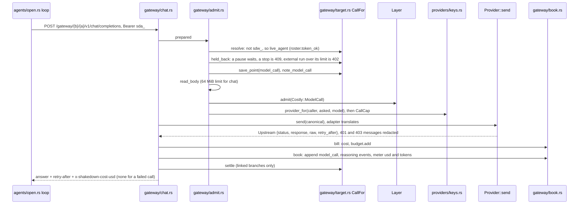
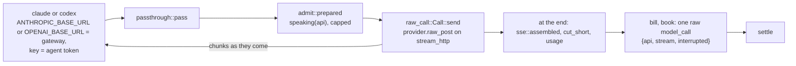
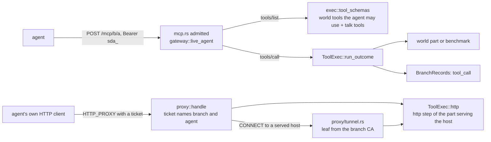
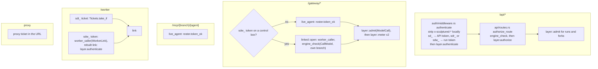

# Model traffic

How an agent under test reaches models, tools and the world's HTTP hosts, how each of those calls is checked,
charged and recorded, and how auth and the layer gate every door. Paths are relative to `core/crates/shaked/`.

## Job

An agent gets three endpoints on its branch, each tied to its agent token (`sda_…`):

- the **model gateway**, `/gateway/{branch}/{agent}/v1/…`: every model call, one `model_call` event each
- the **world MCP endpoint**, `/mcp/{branch}/{agent}`: the world's tools and the talk tools
- the **recording proxy** on 127.0.0.1, for the agent's own HTTP clients (`git`, `gh`, `curl`, SDKs).

shaked holds the model keys. An agent never sees one: the gateway adds the key chosen for the branch's caller.

## Modules

| Module | Job |
|---|---|
| `src/gateway.rs` | Routes, `Api` (`Chat`, `Messages`, `Responses`, `CountTokens`), body limits, `redact`, `answer`, `COST_HEADER`. Its header draws the call path. |
| `src/gateway/target.rs` | `Route`, `CallFor::{Live, Linked}`: whom a call is for. `resolve` reads the credential, `live_agent` checks a live agent's token. Hold, save point and append per branch. |
| `src/gateway/admit.rs` | `let_through` (target, hold, save point), `read_body` (413, 400), `prepared` (layer admits, provider and key, cap). |
| `src/gateway/chat.rs` | `chat/completions`: canonical request through the provider's adapter, answered whole. |
| `src/gateway/passthrough.rs` | `messages` and `responses` sent as they came (Claude Code, Codex). `count_tokens`, neither recorded nor charged. |
| `src/gateway/raw_call.rs` | One passed-through call: sent on the streaming client, relayed chunk by chunk, recorded once at its end, `interrupted` when cut. |
| `src/gateway/sse.rs` | Rebuilds a streamed answer, detects a cut stream, reads usage of either API. |
| `src/gateway/book.rs` | `Outcome`, `call_cost`, `CallFor::bill` (charge and spend estimate), `CallFor::book` (one `model_call`, reasoning, meters). |
| `src/gateway/charge.rs` | What a sandbox's call is charged: its cost, else a ceiling from the price table, else over the limit. |
| `src/gateway/linked.rs` | A branch a sandbox's worker runs, as the control box sees it (see [sandbox runs](sandbox-runs.md)). |
| `src/gateway/forward.rs` | A worker's gateway: forwards to the control box with the worker token only. |
| `src/providers/mod.rs` | `Provider`, `ProviderKind`, `CallCap`, `Upstream`, `send` and `raw_post`. |
| `src/providers/{openai,anthropic,bedrock}.rs` + `anthropic/`, `bedrock/` | Adapters. Canonical format is OpenAI chat completions. Translation is pure (`request.rs`, `response.rs`, `converse.rs`). Bedrock signs with SigV4 and the user's AWS credentials. |
| `src/providers/canonical.rs` | Shared readers and writers of the canonical format. |
| `src/providers/keys.rs` | `provider_for`: your key, then the environment's, then the layer's fallback. `key:<name>` for a shared key. |
| `src/providers/key_check.rs` | Checking a key before it is stored, and the one-token test call. |
| `src/providers/{config,listing,status,reach,transport}.rs` | Environment providers, model lists, `/api/providers`, SSRF guards, the shared wire helpers. |
| `src/agents/mod.rs` | `Driver` trait, `AgentRun`, `AgentResult`, the endpoint URL builder. |
| `src/agents/open.rs` | shaked's own agent loop (`OpenDriver`, `OpenSession`): chat calls through the gateway, then tool calls. |
| `src/agents/{claude,codex,claude_session,usage}.rs` | CLI drivers: commands, MCP config, stream-json usage. |
| `src/agents/cli.rs` | What a CLI agent runs with: MCP endpoint, gateway route in a worker, allowlisted env, time limit, fresh work folder. |
| `src/agents/{http,endpoint_auth}.rs` | `http` agents behind a URL (`shakedown-agent/1`), credentials read per request. |
| `src/agents/session.rs` | Agents that stay alive across turns (dispatch). |
| `src/mcp.rs`, `src/jsonrpc.rs` | The world MCP endpoint: `initialize`, `tools/list`, `tools/call` → `ToolExec::run_outcome`. |
| `src/proxy/` | The recording proxy: tickets, request reading, forwarding, per-branch CA and TLS, `CONNECT` tunnel, record format. |
| `src/budget.rs`, `src/prices.rs` | Spend estimate and limit per run. List prices of `docs/prices.toml`. |
| `src/reasoning.rs` | Reasoning pulled from model responses, recorded as `reasoning` events. |
| `src/auth/` | `Caller`, `engine_check` (`can.rs`), the `/api` middleware, API tokens, run tokens, system scopes. |
| `src/layer.rs`, `src/layer/types.rs` | The `Layer` trait, `LocalLayer`, `WorkerLayer`, `Policy`, the hook types. |
| `src/vault.rs`, `src/secrets.rs` | Stored keys sealed at rest. Header secrets kept by reference. |

## The gateway call path

From the header of `src/gateway.rs`:

```text
route ─ target (whom: live agent | linked worker branch)
      ─ admit  (held back? save point; body read; layer admits; provider + key)
      ─ chat | passthrough → raw_call (sent, answered, a stream relayed)
      ─ book   (billed: charge on a linked branch; one model_call; metered) → settle
```

### An open agent's call (`chat/completions`)



A failed record answers 500 and skips the meters. On a linked branch `settle` still runs first, as in
`raw_call.rs`: a call that took the run over its limit stops the branch whether or not it was recorded.

### A CLI agent's call (`messages`, `responses`)

The request goes to the provider as it came. Only the API's version and beta headers go along from the caller
(`passthrough::api_headers`), never its token. The answer streams back chunk by chunk and is also kept, so the
call is recorded once when it ends, even if the caller left (`raw_call.rs`). A stream cut short is recorded
with what came and `interrupted`.



`count_tokens` is checked and held like a model call, then sent and answered, and neither recorded nor
charged. It takes no in-flight permit on a linked branch.

### Pricing and the spend limit

- `book::call_cost` and an open agent's end (`open::Totals`) price a call the same way, `Provider::call_cost`:
  the provider's reported cost when it gives one, else list price from `prices.rs`, cache writes and cache reads
  at their own rates (`CallTokens::of_usage`). Every route's usage carries those counts: the Claude and Bedrock
  adapters' canonical usage and a Messages call's both come from `providers::canonical::cached_usage`
  (`input_tokens`, `cache_creation_input_tokens`, `cache_read_input_tokens`), a Responses call's as
  `prompt_tokens_details.cached_tokens`.
- `Budget` (`src/budget.rs`) keeps a per-agent running estimate. A turn's reported cost replaces that agent's
  estimate (`settle`). `over()` says why once the estimate passes `max_cost_usd`.
- shaked's own runners stop the agent and end the branch `budget_exceeded`, scored as it stands. On an external
  run the gateway refuses further calls with 402 and records `budget/limit_reached` once
  (`target::over_the_limit`).
- A linked branch is charged on the control box (`charge::linked`). An unknown or cut cost is charged a
  ceiling, and a model with no price is refused 400 (`linked::unpriced`).

## Agents

| Kind | Driver | How it reaches models | How it reaches tools |
|---|---|---|---|
| `open` (also Bedrock agents) | `src/agents/open.rs` | `chat/completions` on the gateway | shaked calls `ToolExec` itself |
| `claude_code` | `src/agents/claude.rs`, `claude_session.rs` | its own login. In a worker, `messages` on the gateway | `--mcp-config` with the world MCP URL, token in a 0600 file |
| `codex` | `src/agents/codex.rs` | its own login. In a worker, `responses` on the gateway | `-c mcp_servers.<server>.url`, token in an env var |
| `http` | `src/agents/http.rs` | its own models | `mcp_url` and `token` in the POST it gets |
| `external` | none: an external system drives it | its gateway URL from `Endpoints` | its MCP URL from `Endpoints` |

Outside a worker, Claude Code's model calls are recorded from its stream-json as reported `model_call`
events (`claude_session.rs`, `usage.rs`). In a worker they go through the gateway and the control box records
them, so the client records none.

A CLI child's environment is an allowlist, applied first; the gateway route and the agent's token are set
after (`src/agents/cli.rs`, `scrub_env`, `ModelRoute`). `scrub_env` removes, by name, every variable of shaked's
that is not on `CLI_ENV` and is not the CLI's own vendor key (`keep`, which the route replaces on a routed run).
`CLI_ENV` is one data list of what a CLI needs to run (paths, user, locale, terminal, time zone, temp and XDG
folders, extra CA certificates; `LC_*` and `XDG_*` by prefix). No proxy variable passes, because one can carry
credentials. The AI reviewer's `claude` gets the same. Removing rather than clearing keeps the base out of what
the command sets, so in a worker's jail (`agents/jail.rs`) the container gets only the route and the token by
name, never the worker's own `HOME` or `PATH`. `a_cli_child_gets_only_the_base_and_its_route` starts a child test
process with a set environment (the base, plus vault, cloud, database, token, secret, password and proxy
variables and a made-up `FOO_BAR_SECRET`). It really starts both routed CLIs' commands there, on a stand-in
program, and checks from `/proc/<pid>/environ` that each started with exactly the base and its route.

## The world MCP endpoint and the proxy



A refused MCP call answers JSON-RPC `-32000` (404: unknown branch or agent) or `-32001` (401: not the agent's
token), with `id: null` (`tests/mcp.rs`, `refusals_carry_their_json_rpc_codes`).

The proxy is one listener on 127.0.0.1 for every branch. The ticket in the proxy URL says which branch and agent
a request is from (`src/proxy/tickets.rs`). A host no part serves, and a served host on a port other than 443,
is refused and recorded (`src/proxy/tunnel.rs`). Each branch has its own CA, given to drivers and agents
through env variables, never a system trust store (`src/proxy/tls.rs`).

## How auth, `can()` and the layer gate each door



`engine_check` (`src/auth/can.rs`) runs before any layer hook:

| Caller | Allowed |
|---|---|
| The person at this machine | everything |
| API token `sd_` | by scope: `read` reads, `run` also starts, forks, stops, records and drives a run, `admin` everything. Changing model keys or project files needs `admin`. No API token calls tools, models or a worker link. |
| Run token `sdr_` | `RegisterAgent`, `Report`, `Finish` on its own branch |
| Worker token `sdw_` | `WorkerLink`, `CallModel` on its own branch |
| Ticket `sdt_` | nothing here: a ticket is checked in memory when a worker trades it for its worker token (`src/worker/tickets.rs`) and never becomes a `Caller`. |
| Agent token `sda_` | nothing here: agent tokens are checked only by their branch's roster (`roster.token_ok`) and never become a `Caller`. |

Another branch than its own is `NotFound` for a run token, so it learns nothing about other branches.

Tokens are `<prefix><64 hex>` and only their sha256 is stored (`src/auth/tokens.rs`). Agent tokens live in
memory only (`src/exec/agent_tokens.rs`). Run, worker and ticket rows are in `run_tokens`, and a token's life
counts only unpaused time (`token_live!` in `src/auth/run_tokens.rs`).

## The layer

`Layer` (`src/layer.rs`) is where the engine asks its deployment. Hooks: `policy`, `authenticate`, `begin`
(after every `BEGIN`), `authorize`, `admit`, `meter`, `fallback_provider`, `audit`, `routes`, `me`,
`object_prefix`, `own_keys`, `principal`, `project_dir`, `keeps_secrets`.

| `Policy` field | `LocalLayer` | `WorkerLayer` | What it changes |
|---|---|---|---|
| `serves_others` | false | false | Bind beyond loopback, Host names, hiding 500 text, vault key required, object store probed |
| `private_model_urls` | true | true | Whether a model server on a private address may be used (`src/providers/reach.rs`) |
| `runs_packages_here` | true | true | `local_only`, routes that change this machine's worlds |
| `environment_keys` | true | false | Whether the operator's `*_API_KEY` and AWS credentials serve callers |

`LocalLayer` and `WorkerLayer` share one implementation through the `PersonalUse` trait. The hosted layer
implements `Layer` in the Cloud repository ([embedding](../embedding.md) lists every hook).

## Invariants

| Invariant | Enforced in |
|---|---|
| Auth runs before the body is read. A call nobody may make never has its body read. | `src/gateway/admit.rs`, `prepared` (`let_through` before `read_body`) |
| Request bodies are capped per API: 32 MiB for Messages and count_tokens, 64 MiB for chat and Responses. | `src/gateway.rs`, `Api::max_body` |
| One `model_call` per call, recorded where the call was made. `count_tokens` is never recorded. | `src/gateway/book.rs`, `src/gateway/raw_call.rs`, `src/gateway/passthrough.rs` |
| The provider gets the key chosen for the branch's caller, never the caller's own credential. | `src/gateway/admit.rs`, `provider`. `src/gateway/passthrough.rs`, `api_headers` |
| A 401 or 403 provider message is replaced before it is recorded or answered. | `src/gateway.rs`, `redact`. `src/gateway/chat.rs`, `redact_rejection` |
| A key's own server is checked against the policy before each call, and at connect time. | `src/providers/keys.rs`, `provider_for`. `src/providers/reach.rs`, `guard` |
| A paused branch holds calls, a stopped branch refuses them. | `src/flow.rs`, `src/gateway/target.rs`, `held_back` |
| Every `/api` route is authorized before its handler. | `src/api/routes.rs`, `authorize_route` |
| Secrets never reach argv or records: Claude's MCP token in a 0600 file, Codex's in an env var, proxied headers without secrets. | `src/agents/claude.rs`, `src/agents/codex.rs`, `src/proxy/record.rs` |

## Extension points

- **A new provider.** Add a `ProviderKind` and an adapter beside `openai.rs`. Keep the translation pure and
  tested on its own. `Api::speaking` decides which pass-through routes it serves.
- **A new agent kind.** Implement `Driver` (`src/agents/mod.rs`), and `session` when it can serve dispatch
  runs (it is async, so a session can read the caller's keys, as the open driver's does with
  `keys::config_for`, and an agent may name `key:<name>`). Register it in `app::install_default_drivers`.
- **A new pass-through API.** Add an `Api` variant and a row in `gateway::ROUTES`. Teach `sse.rs` its usage and
  stream end.
- **Deployment rules.** Implement `Layer`. Never add deployment checks inside the engine.

## Tests

| Test | What it covers |
|---|---|
| `tests/providers.rs`, `tests/provider_keys.rs`, `tests/vllm.rs` | Adapters against fake servers, stored keys, local servers. |
| `tests/gateway_passthrough.rs` | Messages and Responses pass-through, streams, cut streams, linked branches, limits, holds. |
| `tests/open.rs`, `tests/cli.rs`, `tests/http_agent.rs` | The open loop, CLI drivers, `http` agents. |
| `tests/mcp.rs`, `tests/proxy.rs` | The world MCP endpoint and its refusals, the proxy. |
| `tests/budget.rs` | Spend limits for each agent kind. |
| `tests/run_tokens.rs`, `tests/tokens.rs`, `tests/layer.rs` | Token life, scopes, every layer hook. |
| `src/gateway/admit.rs`, `src/gateway/forward.rs` unit tests | Body limits, the worker forwards only its token. |
