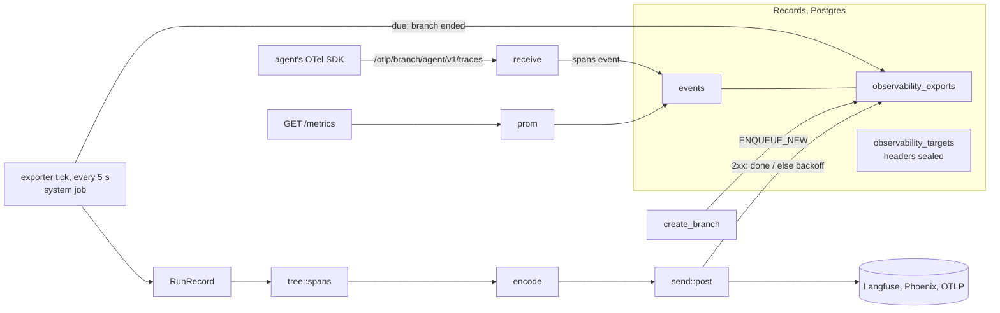

# Observability

How a run becomes an OpenTelemetry trace, how it is queued, sent and retried, where the metrics come from, and how
an agent's own spans get into its record. Paths are relative to `core/crates/shaked/`. The user guide is
[observability.md](../observability.md).

## Job

- Map a branch's stored record to a span tree (GenAI semantic conventions, OpenInference, Langfuse names), with or
  without content, the same spans every time.
- Send it to each target that wants it once the branch ended, from the record, on the machine that keeps the
  records; retry with backoff; record every try.
- Serve the runs as Prometheus text and push them as OTLP metrics.
- Take an agent's own OTLP spans during its run into a `spans` event of that agent.

## Modules

| Module | Job |
|---|---|
| `src/otel/mod.rs` | The module map and the diagram below. |
| `src/otel/proto.rs` | The OTLP trace and metrics messages, written out with `prost`'s derive (no generated code, no gRPC); `AnyValue` to and from JSON. |
| `src/otel/span.rs` | `SpanOut`, `Attr`, `AttrsBuilder`, text cuts (32 KiB), the content keys, deterministic `ids`. |
| `src/otel/tree.rs` | `spans(record, content)`: the walk over a branch's own events, turns opened by `agent_start`/`wake` and closed by `agent_end`/`idle`. |
| `src/otel/steps.rs` | The span of a model call, a tool call, a reasoning step, the check. |
| `src/otel/imported.rs` | `Imported` (what a `spans` event keeps), `Remap`: an agent's spans back out, under its turn. |
| `src/otel/encode.rs` | Spans to `ExportTraceServiceRequest` bodies, 256 spans each; the resource and scope. |
| `src/otel/targets.rs` | The presets: what each asks for, its endpoint and headers, the content default. |
| `src/otel/send.rs` | One POST with a target's headers on the guarded client; `export`, `test`; errors with header values blanked. |
| `src/otel/exporter.rs` | The loop (`every`, `tick`, `push_metrics`) and `export_now` for a request. |
| `src/otel/prom.rs` | The metric families from a `Snapshot`, as Prometheus text and as OTLP metrics. |
| `src/otel/inbound.rs`, `src/otel/receive.rs` | The receiver: protobuf and JSON decoding, bounds, token, quotas, the `spans` event; the agent's `OTEL_*` variables. |
| `src/store/observability.rs` | Targets: sealed headers (`observability_target:<id>:headers`), one per name, audited. |
| `src/store/obs_exports.rs` | The export queue: `ENQUEUE_NEW` (in `create_branch`), due rows, tries, `RunRecord`. |
| `src/store/obs_metrics.rs` | The metrics snapshot; ended branches' call sums kept in memory by branch id. |
| `src/api/observability.rs` | `/api/observability/*`, `POST /api/branches/{id}/export`, `GET /metrics`. |

## Flow

## Invariants

- An export row pairs a branch with a target of the same owner: it is made in the transaction that makes the
  branch, as its caller (`store/runs.rs`, `create_branch`), or by that caller's request (`ask_export`). The
  exporter's system job only works those rows (`obs_exports.rs`, `DUE`), so in a hosted database a run never
  goes to another org's target.
- Only a branch's own events are exported (`seq >= start_seq`); the run span is sent with the run's first
  branch only (`tree.rs`, `heads`).
- Span ids are hashes of the run or branch id and the event's seq (`span.rs`, `ids`): a repeat sends the same
  spans.
- Without content, no prompt, completion, tool argument or result, reasoning or message text leaves; an agent's
  own spans keep only numbers and structural names (`imported.rs`, `structural`). Tested in `tree.rs`.
- Header values are opened only by the exporter, Test and `export_now`, and never logged: errors are blanked
  (`send.rs`, `redacted`). They never reach a worker: the exporter runs in `serve::run`, not in `shaked worker`.
- The receiver takes a live branch's agent's own token only (`gateway::live_agent`), and bounds body, spans and
  rate (`receive.rs`).

## Tests

- `src/otel/tree.rs`: the golden span tree of `tests/fixtures/otel/run_events.json`
  (`SHAKEDOWN_BLESS=1 cargo test -p shaked --lib otel::tree` rewrites `run_spans.json`), one tree, no content
  without content, a fork's spans.
- `src/otel/{encode,inbound,targets,span}.rs`: protobuf round trip, OTLP/JSON, presets, ids.
- `tests/observability.rs`: sealed headers, Test, export, retry and repeat against a fake collector, Prometheus
  and OTLP metrics, the receiver's token, caps and formats.
