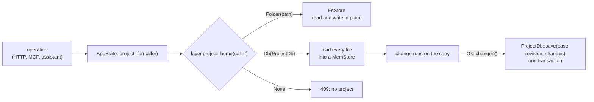

# Project store

A project (`shakedown.yaml`, worlds, scenarios, setups, experiments, world data files and the trash of deletes) is a
set of files at fixed paths. Everything that reads or changes them goes through one narrow trait, so the formats,
loading, cross-file checks, cascading deletes and the trash are written once and work wherever the files live.
Personal use keeps them in a folder. A hosting layer can keep them in its own database: hosted Shakedown keeps each
org's project in Postgres, so no tenant's files sit on its server.

## Modules

| File | What it holds |
|---|---|
| `core/crates/project/src/store/mod.rs` | `Store`: read, `read_head`, list, stat, write (whole file at once), remove, rename, `remove_dir`, `make_dir`, `folder`; `check_path`; `parsed` (a YAML or JSON file as JSON, for a database index) |
| `core/crates/project/src/store/fs.rs` | `FsStore`: a folder; a write goes to a temporary file that is synced, then renamed over the old one; `read_head` refuses a link that leads out of the folder |
| `core/crates/project/src/store/mem.rs` | `MemStore`: files in memory, folders implied by their files; `changes()` lists each path changed since it was made with its new contents (`None`: removed); `read_only` refuses every write |
| `core/crates/project/src/project.rs` | `Project::open_in(store)` and `init_in`; `open(root)` and `init(root)` are the folder's shorthand |
| `core/crates/shaked/src/project_state/` | `ProjectState` (one caller's project and its cache), `Projects` (a cache per home), `ProjectHome`, `ProjectDb` |
| `core/crates/shaked/src/layer.rs` | `Layer::project_home(caller, configured)`, by default the folder `SHAKEDOWN_PROJECT` names |

## Choosing the store

- **Reads.** `ProjectState::current` answers the cached `Project` while its stamp holds: for a folder, the newest
  modification time and entry count of the folders a project reads (`project_state/folder.rs`); for a database,
  `ProjectDb::revision`. A database's copy is a read-only `MemStore`, so a change made on it by mistake fails instead
  of being lost.
- **Changes.** `ProjectState::change(f)` runs `f` on a writable copy. On a folder the files change in place, as
  before. On a database the copy's `changes()` go to `ProjectDb::save` only when `f` succeeds, in one call: a
  cascading delete, a group rename or an undo is saved whole or not at all. `save` refuses with 409 when the project
  moved past the revision the copy was read at.
- **Cache.** `Projects` keeps one cache per home (a folder's path, a database's `key`), shared by its callers. A
  `ProjectDb` handle acts for one caller (it carries the caller's identity for the database's access rules), so
  handles are made per request and only the cache is shared.

## Invariants

- No path leaves the project: every `Store` method refuses an empty, absolute, `.`, `..`, backslash or NUL path, or
  one over 1024 bytes (`store/mod.rs`, `check_path`). The world data view also refuses a link out of a folder
  (`FsStore::read_head`).
- What changed is exactly what is saved: `MemStore` records the last state of each path it touched
  (`store/mem.rs`); `tests/store.rs` checks that a delete, its undo, a regroup and `init` leave the same files in
  memory as on disk.
- The MADL view needs its setup folder on disk for `$ref`s; for a project with no folder it copies that one folder
  to a temporary directory for the request and removes it after (`ops/madl_ops.rs`).

## Tests

`core/crates/project/src/store/tests.rs` (each check on a folder and in memory), `core/crates/project/tests/store.rs`
(a project on disk and in memory stay equal), `core/crates/shaked/src/project_state/tests.rs` (a database project:
one load per revision, nothing saved by a failed change, a stale save refused, a read copy refuses writes). The
hosted Postgres store and its tests are in CopperTide Cloud (`crates/shaked-hosted/src/projects.rs`).
