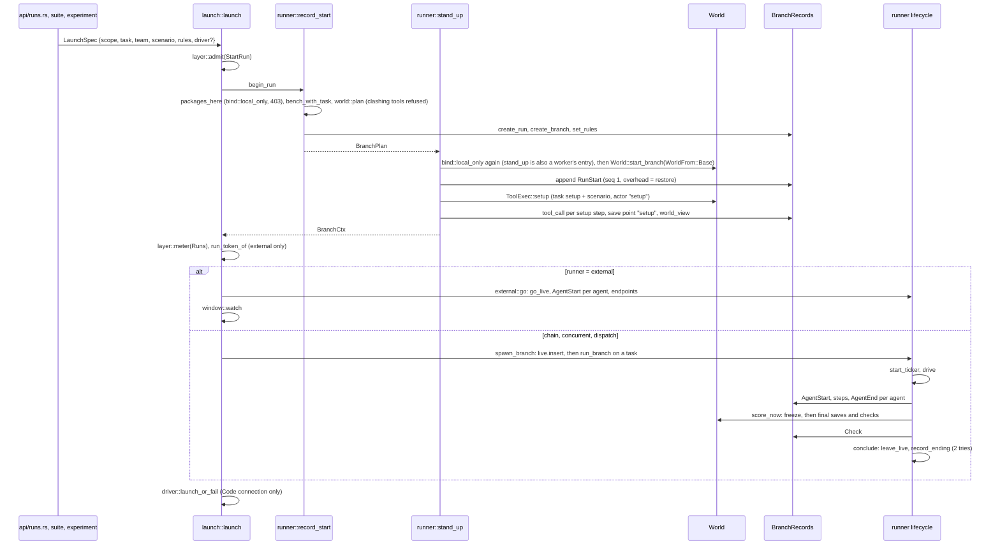
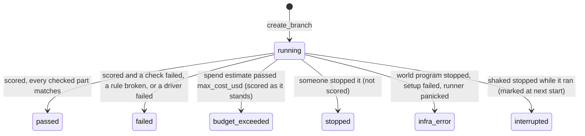
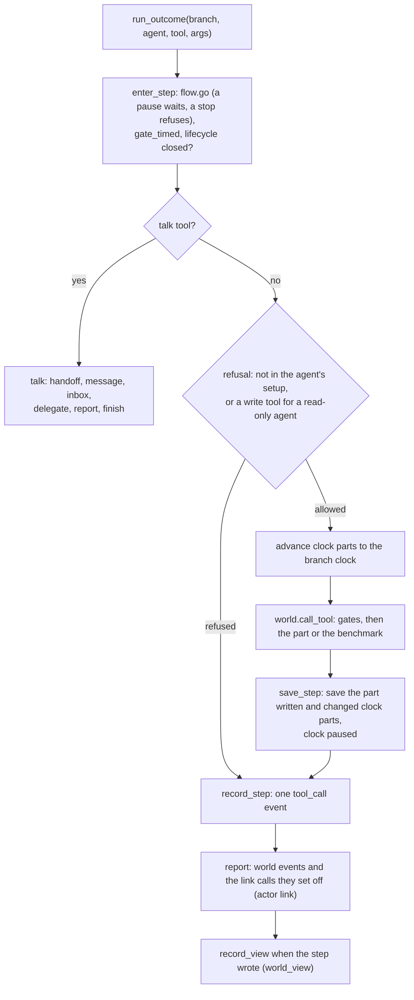
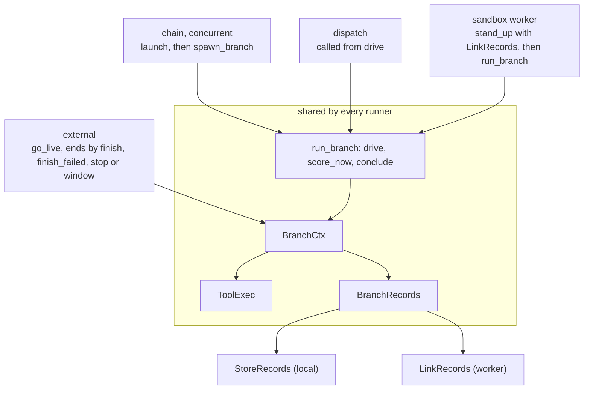
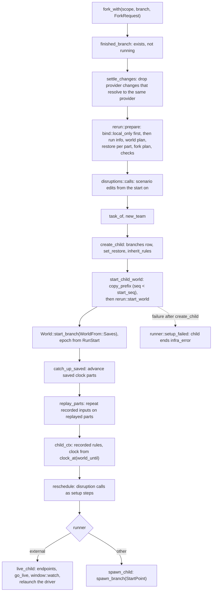

# Runs and worlds

How a run starts, how its steps run and get recorded, how it ends, and how a fork restores a world and runs
again. Paths are relative to `core/crates/shaked/`.

## Job

A **run** is one task of a benchmark played by one team. Its first **branch** starts from the benchmark's base
save. A **fork** is a new branch of the same run that starts at a step of another branch, with the world
restored to how it was before that step. Every branch has one live `BranchCtx` while it runs and one event
log for good.

## Modules

| Module | Job |
|---|---|
| `src/launch.rs` | `launch(state, LaunchSpec)`: the one entry for every new run (`POST /api/runs`, suites, experiments, a suite's claim). |
| `src/runner/start.rs` | `begin_run` = `record_start` (run and branch rows, rules) + `stand_up` (world, `RunStart`, setup). `BranchPlan`, `RunOptions`, `RunError`. |
| `src/runner/lifecycle.rs` | `spawn_branch`, `run_branch`, `go_live`, `finish`, `finish_failed`, `stop`, `conclude`, `Ending`. |
| `src/runner/agents.rs` | `drive`: the chain or concurrent runner, or hands over to dispatch. Agent input and handoff notes. |
| `src/runner/score.rs` | `score_now` = `freeze` (ticker off, clock frozen) + `check` (final saves, gold diff or named checks, `Check` event). |
| `src/dispatch/` | The dispatch runner. `board.rs` is a pure state machine, `session.rs` serves one agent's long-lived session, `inputs.rs` builds prompts, `resume.rs` rebuilds the board on a fork. |
| `src/external.rs` | External runs: `go` (live, `AgentStart` per agent, endpoints), `register`, usage reports, `resumables` for forks. |
| `src/driver.rs` | A Code connection's driver process, launched per run and watched. |
| `src/window.rs` | An external run's world time window: scored when the branch clock reaches its end. |
| `src/exec.rs` | `ToolExec`: run a tool call, save what changed, record it, report links, record the view. `Step`, `CallFacts`. |
| `src/exec/branch.rs` | `BranchCtx`: world, roster, clock, flow, rules, budget, mailbox, lifecycle, overhead, records, the gate. |
| `src/exec/records.rs` | `BranchRecords` trait. `StoreRecords` writes to the store. `LinkRecords` (in `src/worker/`) writes over the link. |
| `src/exec/{talk,dispatch}.rs` | Talk tools (`handoff`, `message`, `inbox`, `delegate`, `report`, `finish`). |
| `src/exec/{setup,links,view,save_point,http}.rs` | Setup steps, link calls, world views, save points, proxied requests as steps. |
| `src/exec/{roster,agent_tokens,mailbox,lifecycle}.rs` | Team and agent tokens, handoff notes and mail, how far a branch is through its life. |
| `src/fork.rs`, `src/fork/` | `plan.rs` (where a fork starts), `changes.rs` (agent changes), `rerun.rs` (how each part is restored, starting the world), `exact.rs` (exactness refusals), `disruptions.rs`, `start.rs` (`fork_with`), `error.rs`. |
| `src/restore.rs` | The restore table. |
| `src/replay.rs` | A part's recorded inputs before a seq, repeated on a fresh instance. |
| `src/recorded.rs` | Pure reads of an event list: `RunInfo`, rules, clock at a seq, saves at a seq, final saves. |
| `src/world/mod.rs` | `World`: start (`start_branch`, `start_planned`), tool routing, `call_tool`, stop. |
| `src/world/part.rs` | One part: its instance, start from a save or empty, connect, HTTP routes, stop. |
| `src/world/{plan,gates,links,saving,scoring,standard,view,systems,hosts,clocked,ids}.rs` | The world's plan and tools, gates, links, saving, scoring, base and gold saves, views, system info, proxy hosts, clock parts, ids. |
| `src/world_builds.rs`, `src/save_calls.rs` | Built worlds and the current benchmark. Calls on saves outside a live world. |
| `src/clock.rs`, `src/world_clock.rs`, `src/ticker.rs`, `src/flow.rs`, `src/overhead.rs` | Branch clock, calendar date, 200 ms ticker, pause and stop, Shakedown's own time. |
| `src/scenario.rs` | Disruptions expanded into setup calls. |
| `src/live.rs` | `LiveBranches`, the branches running in this process. |

## A run's lifecycle

`record_start` and `stand_up` are two halves on purpose. A sandbox run calls only `record_start` on the control
box and hands the `BranchPlan` to the worker, which calls `stand_up` with `LinkRecords`
(`src/worker/run.rs`, `drive`). Both halves together are `begin_run`. `tests/launch_halves.rs` checks that the
halves record the same events as `begin_run`.

### How a branch ends

Rules for the end:

- `spawn_branch` runs `run_branch` inside a second task, so a panic still ends the branch `infra_error`
  (`src/runner/lifecycle.rs`).
- `conclude` always calls `record_ending`, which tries twice. A fatal world error wins over whatever the
  agents did (`lifecycle.fatal()`).
- `Lifecycle::claim_end` lets exactly one caller end an external branch (`finish`, `finish_failed`, `stop`,
  the window).
- `leave_live` stops the ticker, then the world, then removes the branch from `live`, then revokes proxy
  tickets and the branch CA. A cleanup is refused while a branch is live, so this order means a cleanup never
  drops instances still stopping.

## One step

Every tool call of every runner, the MCP endpoint and the proxy goes through `ToolExec`
(`src/exec.rs`).

The gate is a mutex on the branch (`BranchCtx::gate`). The ticker's `tick`, scoring (`score_by_checks`,
`score`) and save points take the same gate, so no step lands between a final save and the checks.

Recording is Shakedown's time: `BranchCtx::append` holds the clock paused while it writes, and each event
carries the overhead since the previous one as `overhead_ms` (`src/overhead.rs`).

## Runners

| Runner | Who drives the agents | Where |
|---|---|---|
| `chain` | shaked, one agent after another, each with the notes before it | `src/runner/agents.rs`, `run_chain` |
| `concurrent` | shaked, all agents at once | `src/runner/agents.rs`, `run_concurrent` |
| `dispatch` | shaked: a lead delegates, agents wake on mail and keep their session | `src/dispatch/mod.rs`, `run` |
| `external` | an external system through each agent's MCP and gateway endpoints | `src/external.rs`, `src/api/external.rs` |

A Code connection is an external run whose driver shaked launches itself (`src/driver.rs`). If the driver
exits while the run is live, the run is scored and ends `failed` with the exit code and the tail of its stderr.

## A fork

`fork_with` in `src/fork/start.rs`:

- **Every refusal comes before `create_child`** (`ForkError`, `src/fork/error.rs`), so a refused fork records
  nothing. `tests/fork.rs`, `assert_bad_forks_make_nothing`, checks this.
- **Where a fork starts** (`src/fork/plan.rs`). The planner picks a start seq per runner. When a part has no
  save at `start - 1`, the start moves back to the last saved point (`saved_point_before`, reason
  `REASON_SAVED`). The answer carries `moved_from` and `reason`.
- **How an agent starts again.** A chain fork restarts the agent at the fork with the earlier agents' handoff
  notes (`StartPoint.notes`). An open agent resumes from the request messages of its last model call before
  the fork (`resume_from_model_call`). A dispatch fork rebuilds the board from the inherited events
  (`src/dispatch/resume.rs`).

### How each part is restored

`src/restore.rs`, the same table as `docs/concepts.md`, "Restore modes":

| Part declares | `exact` | `approximate` |
|---|---|---|
| exact save | from its save | same |
| replay and approximate | replay | from its save, approximately |
| replay only | replay | replay |
| approximate only | refused, naming it | from its save, approximately |
| none | refused | refused |

`Rerun::check` (`src/fork/rerun.rs`) adds the exactness checks: a part that is unrestorable on the way to the
fork (`src/fork/exact.rs`), a world whose `{integration, config}` changed since the run, and replayed parts
whose fingerprint drifted.

## Saves

| When | What | Where |
|---|---|---|
| Run start | The branch starts from the benchmark's base save (`base_<bench>_<version>_<part>`), made once with seed 0. | `src/world/standard.rs`, `ensure_base` |
| After every write step | The part written to and the clock parts that changed. | `src/exec.rs`, `save_step`, `src/world/saving.rs` |
| Save points | Parts with `save_at: "points"`: after setup, before a gateway model call, when a driver asks, and at the end. Recorded as `save_point`, not a step. | `src/exec/save_point.rs` |
| Scoring | Every part's final state, behind the gate. | `src/runner/score.rs` |
| Gold | One gold save per task: the base plus the task's gold actions, made once. | `src/world/standard.rs`, `ensure_gold` |

Ids are `^[a-z0-9_]{1,63}$`: instances `b_<branch>_<part>`, saves `s_<uuid>` (`src/world/ids.rs`). Saves stay
on the parts' own disks under `SHAKEDOWN_SAVES`. `gc::run_startup_gc` drops the saves no event names. The
object store (`src/objects/`) and the `saves` table exist for uploads, which come with hosted forks (M2b).

## World time

- **Branch clock** (`src/clock.rs`). Milliseconds that run at real time × `SHAKEDOWN_CLOCK_SPEED` (default 1)
  while agents work, and stand still while the world is paused: recording, saving, restoring, a pause. A fork's
  clock starts at `clock_at(world_until)` of its parent.
- **Clock parts** (`uses_clock`). The ticker advances them to the branch clock about every 200 ms, behind the
  gate (`src/ticker.rs`, `ToolExec::tick`). Every step advances them first too.
- **Calendar** (`src/world_clock.rs`). A task's `clock_start` is clock 0. Agents get the world's date and time
  in their input. `RunStart.world_epoch_ms` records it and a fork keeps it (`tests/world_time.rs`).
- **Window** (`src/window.rs`). An external run with `world_minutes` is scored when the branch clock reaches
  the window's end. A pause stretches the window.

## Invariants

| Invariant | Enforced in |
|---|---|
| `RunStart` is a branch's first event and holds the world facts (seed, base saves, fingerprints, systems, tools). | `src/runner/start.rs`, `start_world` |
| Every step holds the branch gate, so world order, save order and event order agree. | `src/exec/branch.rs`, `enter_step`. `src/exec.rs`, `tick` |
| Every write step saves its part or records `snapshot_error`. A failed save makes the fork plan move back. | `src/exec.rs`, `save_step`. `src/fork/plan.rs`, `saved_point_before` |
| A branch never stays `running`. | `src/runner/lifecycle.rs`, `spawn_branch`, `conclude`, `record_ending` |
| A fatal world error ends the branch `infra_error`. | `src/runner/lifecycle.rs`, `conclude`. `src/exec.rs`, `failure` |
| A fork refuses before it records anything. | `src/fork/start.rs`, `fork_with` (refusals before `create_child`) |
| A fork's events are the parent's prefix with the same seqs. | `src/store/events.rs`, `copy_prefix` |
| The rules on record are the control box's, and a fork inherits them. | `src/runner/start.rs`, `record_start`. `src/fork/start.rs`, `create_child` |
| Setup and link calls are recorded as tool calls of actors `setup` and `link`, so a replay repeats them. | `src/exec/setup.rs`, `src/exec/links.rs` |
| A shaked whose packages run only in sandboxes never starts a world's parts itself: a run and a fork are refused (403) before anything asks the hub for a program or records a run or branch. | `src/bind.rs`, `local_only`, called first in `src/runner/start.rs`, `record_start` (and again in `stand_up`) and first in `src/fork/rerun.rs`, `prepare` (`ForkError::SandboxOnly`) |

`world/standard.rs`'s `name_lock` keys on the hub's saves folder and the save names, so each shared save is
made once per hub while unrelated hubs never wait for each other.

## Extension points

- **A new runner.** Add a `Runner` variant (`src/model.rs`) and an arm in `runner::agents::drive`. Use
  `ToolExec` for every step and end through `conclude`.
- **A new event kind.** Add it to `EventKind` (`src/model.rs`) and its payload to `payload_kind!`
  (`src/model/payloads.rs`). Pin its JSON in `src/model/payloads/tests.rs`.
- **A new place to record.** Implement `BranchRecords` (`src/exec/records.rs`). `LinkRecords` is the example.
- **A new kind of system in a world.** Write an integration package. Nothing in `core/` changes
  ([protocol](../protocol.md), [packages](../packages.md)).

## Tests

| Test | What it covers |
|---|---|
| `tests/runner.rs`, `tests/launch.rs`, `tests/launch_halves.rs` | Starting runs, the two halves. |
| `tests/fork.rs`, `tests/fork_options.rs`, `tests/restore.rs`, `src/fork/tests.rs` | Fork planning, restore modes, replay, fingerprints, clock at the fork point. |
| `tests/dispatch.rs`, `tests/dispatch_fork.rs`, `src/dispatch/board/tests.rs` | The dispatch runner and its forks. |
| `tests/external.rs`, `tests/connections.rs` | External runs, Code-connection drivers, world windows. |
| `tests/pause.rs`, `tests/world_time.rs` | Pause holds calls and the clock, stop ends unscored, world time. |
| `tests/world.rs`, `tests/links.rs`, `tests/twin.rs`, `tests/saves.rs`, `tests/disk.rs` | World routing, links, gates, setup and named checks, views, saves, disk limit. |
| `tests/records.rs`, `tests/store.rs` | Store records in order. |
