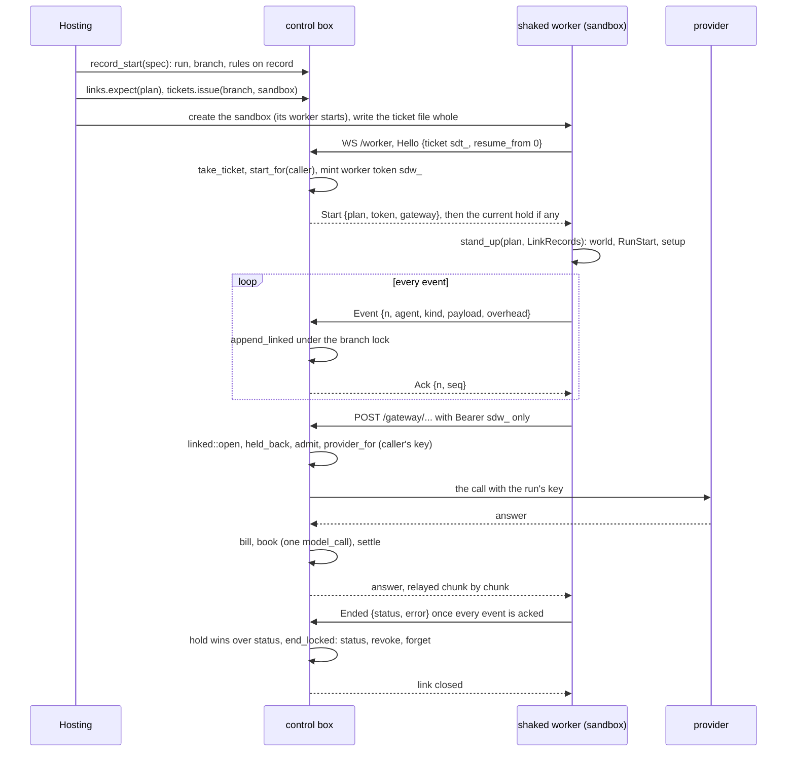
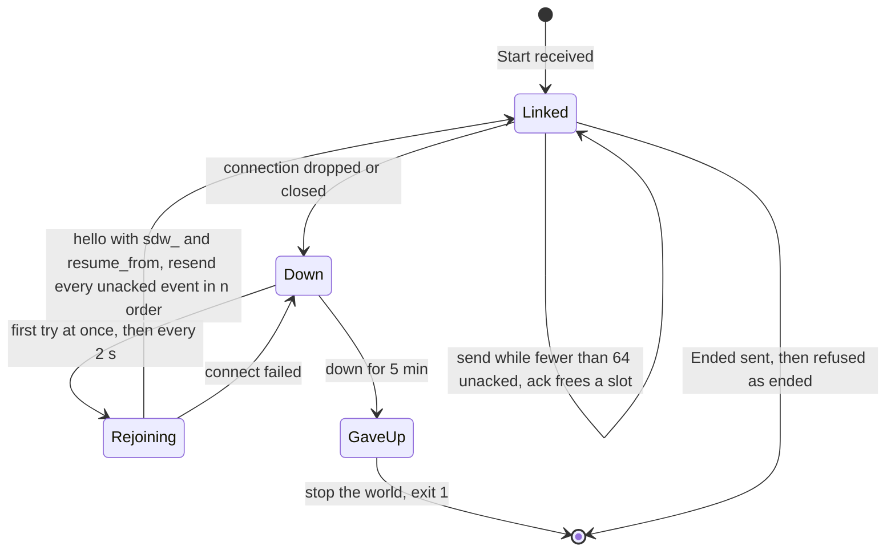
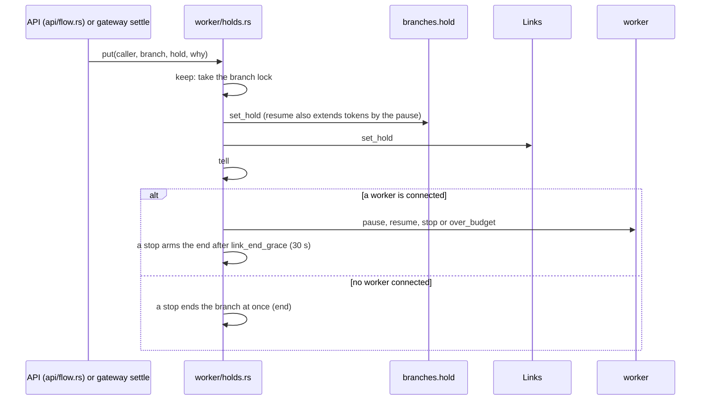
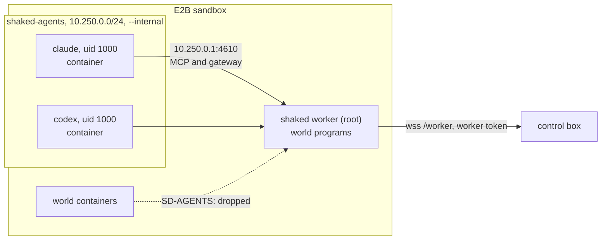

# Sandbox runs

How a branch runs in a sandbox (hosted Shakedown, milestone M2a) while the **control box**, the shaked that
owns the database, stays the authority. Paths are relative to `core/crates/shaked/`.

## Job

In a sandbox run the world and the agents run inside a sandbox. The control box keeps the record, the keys,
the rules and the final word. The two talk over one outbound WebSocket from the sandbox to the control box's
`GET /worker`, and the sandbox's model calls go to the control box's gateway with a worker token.

What exists in the engine today: `shaked worker`, the link on both ends, gateway forwarding, linked-branch
enforcement on the control box, holds and the sweep, the E2B sandbox backend (`src/hosting/e2b.rs`:
create, write a file, kill, state), the E2B template a sandbox starts from, in `deploy/sandbox` (see
[In the sandbox](#in-the-sandbox)), and `Hosting` (`src/hosting/mod.rs`), which runs each new branch of a
control box in a sandbox of its own and kills the sandbox when the branch ends. A control box runs branches
in sandboxes only when the binary embedding shaked sets `ServeOptions::hosting`. The hosted layer does with
`SHAKED_CLOUD=e2b` (CopperTide-Cloud `crates/shaked-hosted/src/cloud.rs`, described in its
`docs/internals/hosted-runs.md`); personal use never does. The link tests play `Hosting`'s part by hand (`tests/support/link.rs`, `ticketed`).

## Modules

| Module | Job |
|---|---|
| `src/agents/jail.rs` | `Jail`: in a sandbox, each CLI agent process runs in a throwaway container on the agent network (`docker run`, the `Container` guard). |
| `src/worker/run.rs` | `shaked worker --link <ws-url> --ticket-file <path>`: waits for the ticket file, opens the link, builds the worker's own shaked, stands the branch up and drives it, obeys controls. |
| `src/worker/client.rs` | The worker's end of the link: hello, `Start`, reconnect, resend, give up (`Patience`, `LinkClient`). |
| `src/worker/link_records.rs` | `LinkRecords`: `BranchRecords` over the link. The outbox, the window, frame cutting. |
| `src/worker/frames.rs` | The frames (`ToControl`, `ToWorker`), `WINDOW` (64), `GIVE_UP` (5 min). |
| `src/worker/link.rs` | The control box's end: `GET /worker`, hello with a ticket or a worker token, append and ack, `Ended`, keepalive, rebuilding a link after a restart. |
| `src/worker/links.rs` | `Links` and `Link`: per branch the plan, caller, budget, hold, in-flight permits, the open connection and the last events appended. |
| `src/worker/holds.rs` | Pause, resume and stop of a linked branch: `put`, `keep`, `tell`, `arm`, `end`, `end_locked`, `sweep`. |
| `src/worker/tickets.rs` | One-use tickets traded for a worker token. Ten minutes, in memory, sha256 only. |
| `src/gateway/forward.rs` | The worker's gateway: forwards each call to the control box with the worker token only. |
| `src/gateway/linked.rs` | The control box's view of a linked call: worker token, link, limits, in-flight permit, hold, `settle`. |
| `src/gateway/charge.rs` | What a linked call is charged when its cost is unknown. |
| `src/store/linked.rs` | `append_linked`: one event per `link_n`, only while the branch runs. |
| `src/store/control.rs` | `branches.rules` and `branches.hold`: what the control box decided, kept from the worker. |
| `src/jobs.rs` | `linked_branches`, `end_linked`, `EndIf`: system jobs for the sweep and ends. |
| `src/layer.rs` | `WorkerLayer`: no vault, no environment keys. |
| `src/model/hold.rs` | `Hold`: running, paused, or stopping with the status the branch ends with. |
| `src/hosting/mod.rs` | `Hosting` (start a branch in a sandbox), `SandboxSpec`, `ProviderRef`, `ProviderState`, the `SandboxBackend` trait, `TICKET_PATH` (`/run/shaked/ticket`), the caps. |
| `src/hosting/watch.rs` | A sandbox's watcher: kills the sandbox once its branch has ended; ends the branch `infra_error` when the sandbox vanished. |
| `src/hosting/worlds.rs` | A world built on the control box, copied into the branch's sandbox before the ticket. |
| `src/hosting/slots.rs` | At most `PER_SCOPE` (1) sandboxes per scope (`object_prefix`: an org on hosted) at a time, counted on this control box. |
| `src/hosting/sweep.rs` | The sandbox sweep: kills this control box's sandboxes whose branch ended or that outlived their timeout. |
| `src/hosting/e2b.rs` | `E2bBackend`: sandboxes on E2B. |
| `src/hosting/fake.rs` | `FakeBackend` (tests, `harness` feature): each sandbox a folder and a local `shaked worker`. |
| `src/launch.rs` | `hosted`: with `AppState::hosting` set, a new run is admitted, recorded (`record_start`), metered and handed to `Hosting`. |

## The whole flow



## The worker

`worker::run::command` (`src/worker/run.rs`):

1. **Ticket file.** It polls `--ticket-file` every 200 ms. A file is read only once it ends with a newline (a
   file still being written is left alone), then trimmed and deleted. Whoever hands the ticket over writes a
   temporary file in the same folder and renames it.
2. **Open.** `client::open` says hello with the ticket and waits up to 60 s for `Start`.
3. **Worker app.** `worker_app` builds a shaked with `Store::detached` (no database: any query fails at once),
   `WorkerLayer`, `ProviderConfig::without_environment()` and `forward_to` set. Its world MCP endpoint, gateway
   and proxy listen on 127.0.0.1. With a jail (`Jail::from_env`), the MCP endpoint and gateway listen on the
   jail's address too, and the CLI drivers hand out URLs on it.
4. **Drive.** `runner::stand_up(plan, LinkRecords)`, then `run_branch`. `obey` applies `Pause`, `Resume`,
   `Stop` and `OverBudget` from the control box.
5. **End.** `until_end` waits for the branch and for the link. A link lost for good stops the flow and the
   world, and the worker exits 1.

## Link frames

One JSON object per WebSocket text message, tagged by `type` (`src/worker/frames.rs`).

| Direction | Frame | Meaning |
|---|---|---|
| worker → control | `hello {ticket, resume_from}` | First frame. `ticket` is a ticket `sdt_` or, on a reconnect, the worker token `sdw_`. `resume_from` is the last `n` acked. |
| worker → control | `event {n, agent, kind, payload, overhead}` | One event. `n` is the worker's counter from 1. |
| worker → control | `ended {status, error}` | How the branch ended. Sent only after every event is acked. |
| control → worker | `start {plan, token, gateway}` | The `BranchPlan`, the worker token, the control box's gateway base. |
| control → worker | `ack {n, seq}` | Event `n` is recorded as `seq`. |
| control → worker | `pause`, `resume`, `stop` | A hold pressed in the UI or by the control box. |
| control → worker | `over_budget {why}` | The spend estimate on the control box passed the limit. The worker stops, the branch ends `budget_exceeded`. |
| control → worker | `refused {why}` | The control box closes the link after this. |

A frame over `MAX_LINK_FRAME` (8 MiB) closes the link with no reason given. So `LinkRecords` cuts an event
whose frame would pass `MAX_EVENT_FRAME` (8 MiB less 64 KiB): long strings are cut to 16 KiB, and a payload of
many short strings is replaced by a summary (`event_frame`). What the worker keeps is what the control box
records.

## The window, resends and give-up



- **Window.** At most `WINDOW` (64) events are on the wire unacknowledged. The rest wait in the outbox
  (`src/worker/link_records.rs`). An event is recorded on the worker only once its ack brings the seq, so
  `append` returns the control box's seq.
- **When the link counts as up again.** An ack, a pause, resume or stop, or a ping while nothing waits on the
  control box (`outbox.owes()` false). A connection that is accepted and then closed, or that pings but never
  acks, does not reset the down clock (`src/worker/client.rs`, `heard`). Tests:
  `a_link_that_is_accepted_then_closed_still_gives_up_and_does_not_spin`,
  `a_link_that_pings_but_never_acks_still_gives_up` in `tests/worker_run.rs`.
- **Give-up.** After `GIVE_UP` (5 min) down, the worker stops its world and exits 1.
  `SHAKEDOWN_WORKER_RETRY_MS` and `SHAKEDOWN_WORKER_GIVE_UP_MS` override both for tests. On the control box the
  branch then stays `running` until a stop, or until the sweep finds its worker token dead (a day after it was
  made). Ending it sooner is the sandbox reconciler's job (M2a Task 8, not built).
- **Idempotent resends.** The control box acks a resent `n` again with the seq it got: from `Link.appended`
  (the last 64) or from the store (`append_linked` finds the row by `(branch_id, link_n)`). A gap (`n` past
  `last_n + 1`) is refused. Tests: `a_dropped_connection_loses_and_doubles_nothing`,
  `a_restarted_control_box_rejoins_without_doubling` in `tests/worker_link.rs`.

## Hosting

`launch` on a control box with `AppState::hosting` set goes through `launch::hosted`:

1. A run an external system or a Code connection drives is refused 422 (`NOT_IN_A_SANDBOX`): those agents
   run on a person's machine, not in a sandbox (not yet).
2. The layer admits the run, and `Hosting::reserve` takes a slot of the caller's scope (the layer's
   `object_prefix`, an org on hosted). A scope runs at most `PER_SCOPE` (1) sandboxes at a time: a run beyond
   that is refused 429 with `BUSY` ("a cloud run of yours is already going (one at a time for now): start
   this one when it ends") before anything is recorded. The watcher gives the slot back once it has killed the sandbox. Then
   `runner::record_unplanned` records the run, its branch and its rules, and the run is metered. Unlike
   `record_start` (which a sandbox-only layer refuses 403), it neither describes the benchmark nor plans
   its world, so no package program starts on the control box: the sandbox's worker does both in
   `stand_up`, and a task the benchmark lacks, or tools that clash, end the branch there, saying why. A run
   that names no benchmark when none is chosen is refused 422 (`NO_BENCHMARK`).
   What the request reads before that never starts a program either: a sandbox-only layer's hub is made
   `Hub::with_programs(false)` (`serve::hub`), so `Hub::client` refuses to start any package program,
   `Hub::bench_describe` reads the benchmark's description file (`describe.json` beside its manifest,
   `parts::described`; missing, it is 409 `NoDescription`), and `gc::usage` (the disk check, health) counts the
   save folders alone. So the control box installs each package's manifest and each benchmark's
   `describe.json`, and nothing else of them (`docs/packages.md`, "The description file").
3. `Hosting::start`: `links.expect(plan)`, then `backend.create(spec)`. A world built on this control box (the
   benchmark's folder is in `Config::worlds_dir`, as the world builder makes it; the template has only the
   installed packages) is copied into the sandbox's `SANDBOX_WORLDS` (`/var/lib/shakedown/worlds`, the
   template's `SHAKEDOWN_WORLDS`), one `write_file` per file, at most 64 MiB (`src/hosting/worlds.rs`). Only
   what `src/hosting/world_files.toml` allows is copied: an allowlist of the extensions and names the world
   builder writes (`benchmarks/world/worldbench/install.py` and the templates' folders), never a name that
   holds a secret (`secrets.json`, `.env`, …), never a symbolic link, never `__pycache__`, `node_modules`,
   `.git` or `.venv`; a `.pem` or `.key` is not on the list. A world that can't be read, or weighs too much,
   ends the branch `infra_error` saying so (`WorldNotCopied`, e.g. "the world w is 65 MiB, over the 64 MiB
   a sandbox takes") before any sandbox is made. The worker scans that folder once `Start` comes. Then a
   ticket (bound to the branch and a new sandbox id) is written newline-ended to `TICKET_PATH`. A sandbox
   that can't take its world or ticket is killed.
   When any of this fails the branch ends `infra_error` with `NO_SANDBOX` ("its sandbox could not start");
   the cause is logged on the control box, never shown (it may carry E2B's answer).
4. A watcher (`src/hosting/watch.rs`) looks every 5 s at the branch and at the sandbox. It kills the sandbox
   once the branch no longer runs, however it ended (the worker's `Ended`, a stop while booting, the link
   sweep). A sandbox the backend reports `Gone` under a running branch (killed, timed out, crashed) ends the
   branch `infra_error` with `SANDBOX_STOPPED` ("its sandbox stopped"); its acknowledged events stay. A branch
   still running at the longest run (`LONGEST_RUN`, or `with_longest_run`) ends `stopped` with
   `LONGEST_REACHED`, and its sandbox is killed: the hard wall-clock cap of a cloud run.

### The sandbox sweep

Watchers live in the control box's memory, so `hosting::sweep_every` (spawned by `serve::run` when hosting is
set, at start and every `link_sweep_every`, 60 s) is their backstop: a watcher a restart lost, a sandbox whose
create answer came back too late. It lists the backend's running sandboxes labelled `shaked=<link host>`,
asks `jobs::running_among` (a system job of the link sweep's) which of their branches still run, and:

| Sandbox | Done |
|---|---|
| its branch ended, or it names none | killed |
| older than the sandbox timeout (`started` label), its branch running | branch ended `infra_error` (`SANDBOX_STOPPED`), sandbox killed |
| otherwise | kept |

E2B's own timeout ends a sandbox even when the control box is down.

**Not built yet (lean M2a):** runs beyond the scope's slot are refused, not queued (`Admission::Queue`, Task 10's
queue); slots and deadlines live in memory, so a restarted control box counts no sandboxes and arms no
deadline for branches already running (the sweep and E2B's timeout still end their sandboxes, and the link
sweep ends their branches when the worker token dies); a running branch whose sandbox vanished while no
watcher ran ends only by that token sweep; quotas from `quotas.toml` (sandbox-hours per month, a global
ceiling) and the sealed envd token (R2) are the hosted layer's to add. There is no `sandboxes` table in the
engine (ruling R6): the backend's labels are the record. The hosted layer wraps the backend so each sandbox gets
its `shakedown_hosted.sandboxes` row, named by the `sandbox` label, before its ticket, and marks the row deleted on
kill (CopperTide-Cloud `crates/shaked-hosted/src/sandboxes.rs`).

The spec a sandbox is created with:

| Field | Value |
|---|---|
| `template` | The `Hosting`'s template (the hosted layer's `shakedown-worker-<rev>`, Task 11). |
| `allow_out` | The link host only. Model calls go through the control box's gateway, so no provider host is needed. |
| `timeout` | The longest run (`LONGEST_RUN`, 55 min, or less with `with_longest_run`) plus `END_GRACE` (5 min), never past `SANDBOX_CAP` (60 min, E2B Hobby's continuous runtime). Never unbounded. |
| `metadata` | `shaked` (the link host: which control box it runs for), `scope` (the layer's `object_prefix`), `run`, `branch`, `sandbox` (the id the worker token names), `started` (unix seconds). Never secrets. |

**The ticket appears whole.** `Hosting` writes it to `<TICKET_PATH>.partial` (`partial_of`) and renames it onto
`TICKET_PATH` (`SandboxBackend::rename`), so the worker, which polls that path, never reads half a ticket. World
files are written directly, one call each: the worker reads them only after it has the ticket.

## The E2B backend

`E2bBackend::new(api_key, api)` (`src/hosting/e2b.rs`, `api` is `https://api.e2b.app`) implements
`SandboxBackend` over E2B's REST API and each sandbox's envd. Endpoints as in E2B's `spec/openapi.yml` and
`spec/envd/envd.yaml`:

| Call | Request | Answer |
|---|---|---|
| `create` | `POST {api}/sandboxes`, `X-API-KEY`, body below | 201 `{sandboxID, envdAccessToken, domain}` |
| `write_file` | `POST https://49983-{sandboxID}.{domain}/files?path=<path>&username=root`, `X-Access-Token`, multipart `file` | 200 |
| `rename` | `POST https://49983-{sandboxID}.{domain}/filesystem.Filesystem/Move`, `X-Access-Token`, Connect RPC JSON `{source, destination}`, `Authorization: Basic root:` | 200 |
| `kill` | `DELETE {api}/sandboxes/{id}`, `X-API-KEY` | 204; a 404 counts as killed |
| `state` | `GET {api}/sandboxes/{id}`, `X-API-KEY` | 200 `state: running` is `Running`; 404 or any other state is `Gone` |
| `list` | `GET {api}/sandboxes?metadata=<k=v&…>`, `X-API-KEY`; keys and values URL-encoded, then the whole once more | 200 `[{sandboxID, metadata}]`, running sandboxes only |

The create body:

```json
{"templateID": "<spec.template>", "timeout": <spec.timeout in s>, "secure": true,
 "metadata": {"...": "..."},
 "network": {"allowOut": ["<spec.allow_out>"], "denyOut": ["0.0.0.0/0"], "allowPublicTraffic": false}}
```

- **Egress.** Everything is denied but `allow_out`: the control box's link host and the hosts the agent setup
  allows. With `allowPublicTraffic: false`, E2B's spec says sandbox URLs take no traffic without the
  sandbox's traffic token (not tested here; envd still answers with its access token, checked live).
- **Keys.** The E2B key goes only to E2B's API, never to envd or into a sandbox
  (`write_file_sends_the_access_token` checks the envd request carries no `X-API-KEY`). The envd access token
  of each sandbox is kept in memory only, by sandbox id; a control box that restarts cannot write into the
  sandboxes it made before (Task 8 keeps it sealed with the vault key).
- **Domain.** When E2B names no `domain`, envd is on `e2b.app`.
- **Files** are written as root, so `TICKET_PATH` under `/run` is writable; envd makes the folders.
- **Errors** name the call, E2B's status and up to 500 characters of its answer.
- `with_envd(base)` sends every envd call to one base instead of the sandbox's host (the unit tests' mock).
- `read_file` reads a file back (the live check).

## The control box's end

`src/worker/link.rs`:

- **Hello.** It must come within `link_hello_timeout` (10 s). A ticket is taken only while its branch's link
  waits for a worker (`take_ticket`). Of two tickets for one branch only one makes a token (`start_for`). When
  the token cannot be minted, the claim is let go and the ticket given back.
- **Rejoin.** A worker token resolves through `run_tokens::worker_caller(WorkerLink)`. The branch must still be
  `running`, and `resume_from` must not pass the last event appended.
- **Rebuild after a restart.** When this control box has no `Link` for the branch, `rebuilt` asks
  `layer.authenticate` who the token acts for, then, under the branch lock, reads the last `link_n` and what
  the branch is held to (`on_record`). A spend limit recorded reached whose hold was lost is put back on
  `budget_exceeded`. A stopping branch has its end grace armed again.
- **Keepalive.** The control box pings every third of `link_idle_timeout` (60 s) and closes a link silent for
  all of it.
- **Ended.** Under the branch lock: read the hold. If the branch is stopping, the hold's status wins over the
  reported one. Then `holds::end_locked`: status set, tokens revoked, link forgotten.

## Holds



- A hold is kept in the store first, so a restart keeps it, then on the link, both under the branch lock
  (`keep`).
- The gateway enforces the hold on every model call whether a worker is connected or not
  (`Linked::held_back`): paused is 409 with `x-shakedown-held: paused`, stopping is 409, stopping for the
  limit is 402.
- The worker's gateway answers a 409 `held: paused` by polling every 200 ms and sending the call again, so a
  pause it has not heard of yet holds the call rather than failing it (`src/gateway/forward.rs`).
- A resume extends the worker token by how long the pause lasted. A token's life counts only unpaused time
  (`token_live!`).

## Budgets on a linked branch

The control box keeps the run's spend estimate in `Link.budget`, from the rules it planned the branch with.

| Step | Where |
|---|---|
| Rules not on record (a branch from before 0005): every call is 503 `NO_LIMITS`, never unlimited. | `src/gateway/linked.rs`, `open` |
| A model with no provider cost and no price in the table is refused 400. | `src/gateway/linked.rs`, `unpriced` |
| A call that answered with no cost, or a cut stream, is charged a ceiling from the highest prices the table lists for its provider. When there is none, a run with a limit is forced over it. | `src/gateway/charge.rs`, `linked` |
| What was charged is kept on the event (`charged_usd`, `estimated`), so a restarted control box rebuilds the estimate. | `src/gateway/book.rs`, `bill` |
| As soon as a charge puts the run over, `settle` keeps the hold `budget_exceeded`, records `budget/limit_reached` at the branch's last world clock, and tells the worker. | `src/gateway/linked.rs`, `settle` |
| The worker's own estimate comes first for a well-behaved worker, never instead. A control-box 402 forces the worker over. | `src/gateway/forward.rs`, `over_budget` |
| At most 4 model calls in flight per agent. A call waits up to 10 s for a permit, then 429. | `src/worker/links.rs`, `INFLIGHT_PER_AGENT`. `src/gateway/linked.rs`, `in_flight` |

## The sweep

`holds::sweep_every` runs at start and every `link_sweep_every` (60 s), spawned by `serve::run`. For every
running branch that ever had a worker token (`jobs::linked_branches`):

- paused: left alone (its resume extends the token)
- stopping: the end grace is armed again (a restart lost the timer)
- otherwise, worker token dead: ended `infra_error` with `TOKEN_DIED`, only if it is still unpaused and no
  worker token is live when it ends (`EndIf::TokenDied`, checked in the same statement).

At start, `jobs::interrupt_at_start` leaves a branch with a live worker token `running`, so its worker can
reconnect.

## Invariants

| Invariant | Enforced in |
|---|---|
| The sandbox holds no key but its worker token. | `deploy/sandbox/worker.env`. `src/layer.rs`, `WorkerLayer`. `src/worker/run.rs`, `worker_app`. `src/gateway/forward.rs`, `onward`. `tests/worker_run.rs`, `a_workers_model_calls_carry_no_model_key_and_are_recorded_once` |
| A worker token opens only its own branch, and a worker's own gateway refuses one (401). | `src/auth/can.rs`, `in_run`. `src/gateway/target.rs`, `resolve`. `tests/gateway_passthrough.rs`, `a_worker_token_reaches_only_its_branch`, `a_worker_token_at_a_workers_own_gateway_is_refused` |
| `seq` is assigned only on the control box, under the same lock as its own events. | `src/store/linked.rs`, `append_linked`. `src/gateway/target.rs`, `CallFor::append` |
| An event is appended once per `n`, also across reconnects and restarts. | `core/crates/shakedown-schema/migrations/shakedown/0004_event_link_n.sql`. `src/worker/links.rs`, `Appended::resent` |
| An ended branch takes no more events. | `src/store/linked.rs` (`HAVING EXISTS … status = 'running'`) |
| The rules, the hold and the spend estimate are the control box's, and survive a restart. | `src/store/control.rs`. `src/worker/link.rs`, `on_record`. `tests/gateway_passthrough.rs`, `a_restarted_control_box_keeps_the_limit_and_the_spend`, `a_worker_written_limit_counts_for_nothing` |
| A stop pressed on the control box ends the branch with the hold's status, whatever the worker reports. | `src/worker/link.rs`, `ended`. `src/worker/holds.rs`, `tell`, `arm` |
| Every end holds the branch lock over the status and the revoke, so no worker event lands after it. | `src/worker/holds.rs`, `end`, `end_locked` |
| In a sandbox, a CLI agent runs as uid 1000 with no capabilities, gets only its own variables (none in argv), and reaches only the worker's agent port. | `src/agents/jail.rs`, `docker_run`. `deploy/sandbox/agent-network.sh`. `src/agents/cli.rs`, `in_a_worker_cli_agents_run_unprivileged_on_the_agent_network`. `deploy/sandbox/check-template.sh` |
| One `model_call` per call, recorded on the control box. The worker records none. | `src/gateway/forward.rs`. `src/agents/claude_session.rs` |

## In the sandbox

The template (`deploy/sandbox`, built by `build-template.sh`) holds Ubuntu 24.04 with Docker, `shaked` and the
package programs, the packages with their Python environments synced, Python with `uv`, Node 22, PostgreSQL
on `127.0.0.1:5544` (`SHAKEDOWN_PG_URL`), the agent image (Claude Code and Codex) and every world image:
`images.txt`, the world templates' `images.yaml` and what software-factory builds. Its start command, `start.sh`, runs while
E2B builds the template, so every sandbox starts from a snapshot in which the worker already waits for its
ticket.



- **Start.** `start.sh` makes sure `docker.service` and `postgresql.service` run (the VM boots systemd), runs `agent-network.sh`, then
  `shaked worker --link "$SHAKED_LINK" --ticket-file /run/shaked/ticket`. The ready command is `docker info`.
  Settings come from `/etc/shaked/worker.env`; `SHAKED_LINK` and `SHAKED_AGENT_IMAGE` are baked in per
  template.
- **The agent network.** `shaked-agents` is `--internal`: nothing on it is routed off it. The `SD-AGENTS`
  iptables chain takes every packet that comes in from the network's bridge or is for its gateway address,
  and accepts only TCP from the bridge to the agent port. World containers and local programs cannot reach
  that address.
- **The jail.** `Jail::contain` gives the work folder to uid 1000, then wraps the CLI's command as
  `docker run --rm -i --name shaked-agent-<id> --user 1000:1000 --network shaked-agents --cap-drop ALL
  --security-opt no-new-privileges --memory 1g --pids-limit 256 --read-only --tmpfs /tmp --tmpfs
  /home/agent:… --mount type=bind,src=<dir>,dst=<dir> -w <dir> -e NAME … <image> <command>`. Each variable the
  command sets is passed by name, its value in the `docker` process's environment. The variables the scrub
  removes are removed from `docker`'s environment as well. A killed `docker run` leaves its container
  running, so `Container`'s drop runs `docker rm -f` (one-shot runs in `run_in_workdir`, sessions in
  `claude_session::Process`).
- **No key.** `worker.env` holds no secret. The sandbox's only credential is the worker token its ticket
  becomes.

## Extension points

- **A sandbox backend.** Implement `SandboxBackend` (`src/hosting/mod.rs`) as `E2bBackend` does; `rename`
  must be atomic within a folder. `Hosting` and the link need no change for it.
- **A new control frame.** Add it to `ToWorker`, handle it in `worker::run::obey` and pin its JSON in
  `src/worker/frames.rs` tests.

## Tests

| Test | What it covers |
|---|---|
| `tests/worker_link.rs` | Tickets, order, dropped connections, control-box restarts, holds before start, silent links, ended branches. |
| `tests/worker_run.rs` | A real `shaked worker` end to end on the toy world, rejoin, cut-down events, give-up, stop, model calls without keys. |
| `tests/gateway_passthrough.rs` | Linked calls: worker tokens, limits, holds, restarts, unpriced models. |
| `tests/run_tokens.rs` | Worker and ticket tokens, a worker token needing its sandbox, pauses extending tokens. |
| `src/worker/link_records.rs`, `src/worker/frames.rs` unit tests | The window, resends in order, the end after every ack, frame cutting, frame JSON. |
| `tests/support/link.rs` | Shared link plumbing: `ticketed`, `started`, `restarted`, `hear`. |
| `src/hosting/e2b.rs` unit tests | The E2B calls against a local mock of E2B's API and envd: the create body, 404s on kill and state, a write and a rename, the envd token and no E2B key on both; `src/hosting/worlds.rs`: only allowed world files are copied, never secrets or keys. |
| `tests/hosting.rs` (fake) | `a_run_with_hosting_runs_in_a_fake_sandbox` (the branch ends `passed`, one create, one kill), `an_external_run_is_refused_on_hosting`, `a_vanished_sandbox_ends_its_branch_infra_error`, `the_sweep_kills_sandboxes_whose_branch_ended_or_that_outlived_their_timeout`, `a_second_run_for_the_org_is_refused_until_the_first_ends`, `a_run_past_its_longest_is_stopped_and_its_sandbox_killed`, `a_world_built_here_is_copied_into_its_sandbox` (the fake sandbox has the toy integration only), `a_world_too_big_for_a_sandbox_ends_its_branch_saying_so`, `a_sandbox_only_control_box_runs_a_branch_without_a_package_program_here` (a layer whose packages run only in sandboxes). |
| `tests/hosting.rs` (live) | `live_hosting_hands_an_e2b_sandbox_its_world_and_ticket_and_kills_it` (`#[ignore]`, `E2B_API_KEY`; `SHAKEDOWN_E2B_TEMPLATE` names a `shakedown-worker-…` template, else E2B's `base`): a run of a world built on the test control box through `Hosting`, its link host one no worker answers on: the world's manifest is in `SANDBOX_WORLDS`, the worker took the whole ticket (on `base`: the ticket is whole at `TICKET_PATH`) and no partial file stayed, a stop ends the branch, the watcher kills the sandbox, and no sandbox of the test's link host is listed after. |
| `tests/support/scripted.rs` | The scripted `http` agent the worker and hosting tests share. |
| `tests/hosting.rs` | `live_e2b_create_write_kill` (`#[ignore]`, needs `E2B_API_KEY`): a real sandbox from E2B's `base` template is running, takes a ticket at `TICKET_PATH` and reads it back, is killed, then is `Gone`. Its timeout is 2 minutes in case the kill fails. |
| `src/agents/cli.rs`, `src/agents/jail.rs` unit tests | The jailed command line, the jail's variables. |
| `deploy/sandbox/check-template.sh` (live, real E2B) | A sandbox from the template: dockerd, the images, the worker waiting for its ticket, the agent network reaching the agent port and nothing else. |
